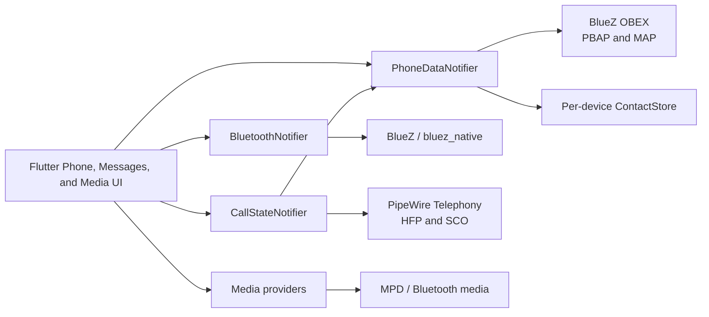

# GSoC 2026 Final Report: AGL Bluetooth Integration

## Project overview

This project extends the Automotive Grade Linux (AGL) Flutter Instrument
Cluster and Infotainment homescreen with production-oriented Bluetooth phone
integration. The work connects the existing Flutter interface to native Linux
Bluetooth and audio services so a driver can pair a phone, browse contacts and
call history, manage calls, exchange messages, and use Bluetooth media without
demo data or platform-specific UI code.

The implementation targets the AGL Linux environment and keeps the Flutter
application responsible for presentation and state coordination. BlueZ,
BlueZ OBEX, PipeWire Telephony, and MPD remain the system-facing backends.

Repository: <https://github.com/jaydon2020/flutter-ics-homescreen>

Development branch at final validation: `hfp-agl-testing`  
Validated commit: `06d5a2e`

## Goals and outcomes

| Goal | Outcome | Status |
| --- | --- | --- |
| Integrate native Bluetooth device management | Added adapter power, discovery, pairing, trust, connection policy, supported-profile filtering, and device lifecycle handling through `bluez_native`. | Completed |
| Add PBAP phonebook support | Added contact and recent-call synchronization, vCard parsing, revision-aware refresh, per-device persistence, and caller-name resolution. | Completed |
| Add HFP telephony support | Added gateway selection, call state, call controls, DTMF, gain/mute controls, and SCO transport activation through PipeWire Telephony. | Completed |
| Deliver an automotive phone UI | Added Dial, Contacts, Recents, incoming-call, ongoing-call, active-call, keypad, call-waiting, and multiparty controls. | Completed |
| Support Bluetooth messages | Added MAP conversation loading, message bodies, attachments, read state, notifications, and sending as an extended project goal. | Completed |
| Preserve media behavior | Integrated Bluetooth media source handling and prevented conflicting playback when switching sources. | Completed |
| Make the integration resilient | Added per-device isolation, stale-result protection, serialized profile work, retry handling, atomic cache writes, and service recovery. | Completed |
| Prepare the feature for AGL deployment | Added native-asset build guidance, Linux/AGL runtime documentation, CI gates, and a real-device test plan. | Completed; final hardware matrix remains |

## Architecture

The implementation separates device management, profile access, state, and UI
so that each backend has one clear owner.



- `BluetoothNotifier` owns adapter and device lifecycle, pairing requests,
  connection policy, and supported-profile checks.
- `PhoneDataNotifier` owns PBAP and MAP sessions, synchronization, refreshes,
  and phone-switch generation checks.
- `ContactStore` persists phonebooks by normalized Bluetooth address.
- `CallStateNotifier` owns HFP call state and commands and binds them to the
  currently selected Bluetooth gateway.
- Native backend interfaces isolate Flutter state from FFI and D-Bus details,
  which also makes the behavior testable without a physical phone.

## Major work completed

### 1. Bluetooth device integration

The original Bluetooth settings flow was expanded into a stateful native
integration. It now manages discovery, pairing prompts, trust, connection and
disconnection, device removal, and a single-active-phone policy. Supported
phone profiles are detected from BlueZ UUIDs and device class information.

External or stale connection events are checked against the active operation,
and asynchronous events cannot silently replace the selected device. HFP
profile activation targets the selected BlueZ object and treats an already
connected profile as success.

### 2. PBAP contacts and call history

PBAP support retrieves contacts and incoming, outgoing, and missed call
history through `bluez_obex_native`. The implementation parses vCards, contact
photos, multiple phone numbers, timestamps, and call direction into typed
Flutter models.

Contacts are stored separately for every phone. Reconnecting a phone restores
its cached contacts immediately and checks PBAP database/version counters
before downloading again. When a phone does not expose those optional
counters, the app compares the complete handle/name listing. A manual refresh
is available for number-only or photo-only edits that listings cannot detect.

Cache writes are serialized and atomic. The data directory is mode `0700` and
the cache is mode `0600`. Failed or incomplete transfers retain the last valid
phonebook instead of replacing it with partial data.

### 3. HFP calling and SCO audio

The phone application follows the connected Bluetooth address and selects the
matching PipeWire Telephony gateway. It supports:

- dialing from the keypad, contacts, recents, and message conversations;
- incoming, outgoing, dialing, alerting, waiting, active, held, ended, and
  multiparty call states;
- answer, decline, hang up, DTMF, mute/unmute, swap, end-and-swap, merge,
  hold-and-answer, and end-and-answer operations;
- caller-name and photo resolution using only the connected phone's contacts;
- microphone and speaker gain state; and
- SCO activation after an active call receives a usable transport.

Commands are serialized so rapid taps do not submit duplicate operations.
Call state is generation-scoped, preventing results from a disconnected phone
or old gateway from updating a newly selected phone. Transport, codec, and
RejectSCO fields are cleared when the backend removes them.

### 4. MAP messaging

MAP was delivered as an extended Bluetooth integration goal. The Messages app
loads conversations and message bodies, retains attachments across listing
refreshes, resolves contacts, handles alphabetic senders, marks messages read
when supported, and sends correctly framed bMessages.

PBAP and MAP failures remain independent: denying message access does not
disable contacts or calls. Folder selection and sending are serialized to
prevent concurrent OBEX operations from changing one another's context.

### 5. Automotive user experience

The Flutter UI includes Phone and Messages launchers and responsive layouts for
the desktop development viewport and automotive landscape displays. Call
overlays remain visible outside the Phone screen. Controls expose explicit
disabled and error states, use large touch targets, and only show operations
valid for the current call topology.

The dialer supports contact suggestions and preserves the selected contact name
through the outgoing-call transition. Bluetooth media is paused when switching
to another audio source to avoid competing playback.

### 6. Native build and deployment support

The project uses Dart native assets for `bluez_native`,
`bluez_obex_native`, and `pipewire_telephony_native`. Documentation covers host
bootstrap, native submodules, Flutter Linux bundles, AGL cross-compilation, and
the target-correct `native_assets.json` required by Flutter 3.38 AOT builds.

The application checks the session bus before falling back to the system bus,
supporting both desktop WirePlumber services and the AGL service layout.

## Reliability and security improvements

- Phone data is always keyed by an explicit Bluetooth address.
- Switching phones clears old visible data before loading the next cache.
- Provider lifecycles use generation checks to reject stale asynchronous work.
- PBAP operations share a queue so folder selection cannot race.
- Cleanup removes only sessions created by this application.
- Transfer completion requires positive evidence and valid payloads.
- Cached contacts remain available after transient PBAP or storage failures.
- Contact storage uses restricted permissions and atomic replacement.
- Service clients retry recoverable outages with bounded backoff.
- Production paths do not substitute demo contacts, calls, or messages.

## Testing and validation

Final automated validation was run on 1 November 2026 at commit `06d5a2e`:

```text
flutter analyze --no-fatal-infos  PASS
flutter test --reporter compact   PASS (103 tests)
```

Analysis completed without errors or warnings; existing informational style
and deprecation notices remain visible. The automated suite covers:

- native HFP profile invocation and UUID matching;
- PBAP parsing, revision checks, fallback listings, forced refresh, and
  incomplete transfer handling;
- per-device persistence, migration, permissions, corruption, and concurrent
  saves;
- phone switching and stale-result isolation;
- MAP refresh, body/attachment retention, sender separation, and sending;
- gateway selection and all exposed telephony commands;
- call waiting, held/active topology, multiparty controls, duplicate taps,
  mute restoration, SCO lifecycle, and service recovery;
- Phone, Messages, overlay, media, and automotive-layout widget behavior; and
- retry behavior for related AGL runtime services.

Automated checks use fake backends and simulated services where appropriate.
They do not prove phone-vendor interoperability, target D-Bus policy, radio
conditions, or physical SCO audio quality.

## Challenges and engineering decisions

### Optional and inconsistent phone capabilities

PBAP version counters are optional, MAP operations vary by phone, and some
devices publish profiles only after pairing. The implementation therefore uses
capability checks and safe fallbacks rather than assuming one vendor behavior.

### Multiple asynchronous systems

BlueZ, OBEX, PipeWire, Riverpod, and the Flutter UI all emit state
independently. Serialized lifecycle work and generation identifiers were used
to ensure that late events cannot cross phone boundaries.

### Native asset cross-building

The native packages must be built for the AGL target and registered in the AOT
native-asset manifest. Host-built shared libraries cannot be copied into the
image. The resulting workflow and runtime paths are documented for future AGL
integrators.

### Safety-oriented call controls

The UI derives available actions from the complete call topology. It does not
show unsupported single-call hold controls, and pending commands disable
overlapping actions. This keeps the interface predictable when phones expose
different call-control capabilities.

## Remaining work

The software goals are implemented, but release sign-off still requires the
manual target matrix in `docs/phone_integration_test_plan.md`:

1. Validate PBAP permissions, revisions, and large phonebooks on multiple
   Android and iOS versions.
2. Validate incoming, outgoing, waiting, held, swapped, merged, and multiparty
   calls on the AGL target.
3. Verify bidirectional SCO audio, codec negotiation, gain, routing, latency,
   and recovery after transport removal.
4. Verify MAP interoperability and sending on phones that require different
   message-access permissions.
5. Confirm target D-Bus policy and native asset installation in the final AGL
   image.
6. Complete accessibility and distraction testing on the intended display and
   input hardware.

## Reproducing the validation

```sh
flutter pub get
dart run tool/bootstrap_native_dependencies.dart
flutter analyze --no-fatal-infos
flutter test --reporter expanded
```

For hardware validation, follow `docs/phone_integration_test_plan.md` and record
the target image, application commit, phone model/OS, case IDs, and redacted
evidence for each run.

## Related documentation

- [`native_phone_integration.md`](native_phone_integration.md)
- [`phone_contact_telephony_review.md`](phone_contact_telephony_review.md)
- [`phone_integration_test_plan.md`](phone_integration_test_plan.md)
- [`runtime_services.md`](runtime_services.md)
- [`native_library_feature_matrix.xlsx`](native_library_feature_matrix.xlsx)

## Conclusion

The project moved AGL's Flutter homescreen from a visual Bluetooth settings
demo to a native phone-integration stack with persistent contacts, call
history, HFP calling, SCO audio coordination, messaging, media coexistence, and
failure recovery. The architecture keeps platform services behind testable
providers and native backend interfaces, while the completed documentation and
103-test suite provide a practical base for final hardware qualification and
upstream review.
