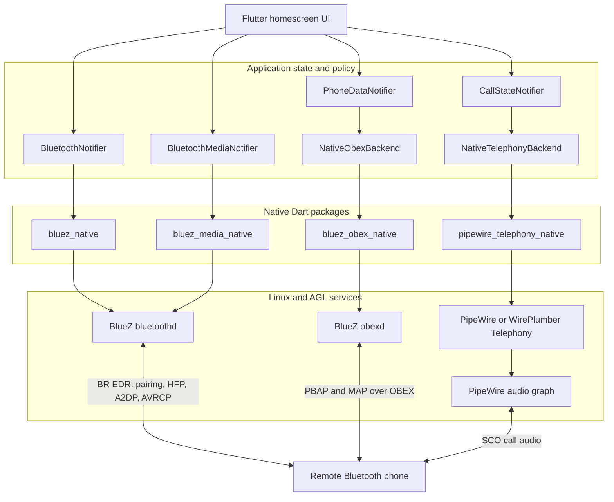
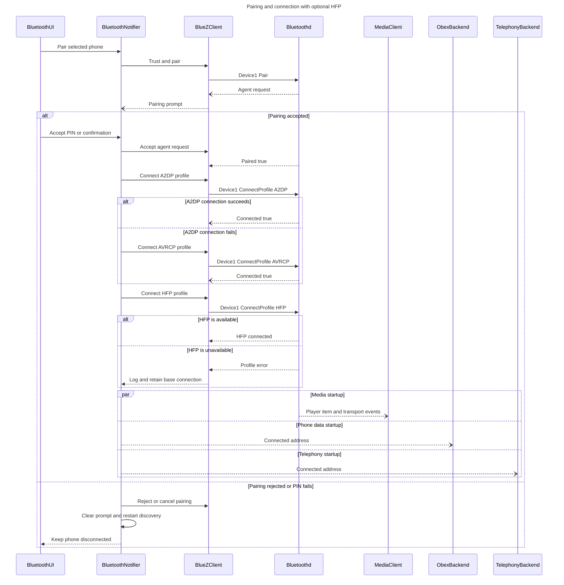

# Native Bluetooth libraries: API and architecture report

## Purpose and scope

This document describes the four native Dart libraries used by the AGL
homescreen for Bluetooth device management, media, phone data, and telephony.
The API names were checked against the package versions resolved by this
checkout on 2026-11-01.

“Library support” means that the installed package exposes the API. “Used by
the homescreen” means that production code in this repository currently calls
it. A feature can therefore be supported by a library without being exposed in
the current user interface.

## Executive summary

| Library | Resolved constraint | Native service or protocol | Primary responsibility | Homescreen integration |
| --- | --- | --- | --- | --- |
| `bluez_native` | `^0.3.2` plus reviewed API override | BlueZ `bluetoothd` on the system D-Bus | Adapter power, discovery, pairing, trust, profile-specific connection, pairing-agent events, and GATT | `BluetoothNotifier` |
| `bluez_media_native` | `^0.3.1` | BlueZ Media1 interfaces | AVRCP player state and commands, browsing, cover art, A2DP transport state and volume | `BluetoothMediaNotifier` |
| `bluez_obex_native` | `^0.1.0` | BlueZ `obexd` on the session D-Bus | PBAP contacts, MAP messages, OBEX sessions, and transfer control | `NativeObexBackend` and `PhoneDataNotifier` |
| `pipewire_telephony_native` | `^0.1.0` | PipeWire/WirePlumber Telephony D-Bus service | HFP call control, call state, volume, and SCO transport control | `NativeTelephonyBackend` and `CallStateNotifier` |

The libraries have separate lifecycles and intentionally do not replace one
another. `bluez_native` establishes and owns the Bluetooth device connection;
the other three libraries consume the media, OBEX, and telephony objects that
become available for that connected phone.

The table describes service boundaries, not a common C++ transport. Flutter
uses each package's public Dart API backed by its native FFI library. Internal
D-Bus/client dependencies are package- and version-specific implementation
details and must not be generalized across every native package.

## System architecture

### Runtime ownership

| Layer | Owns | Does not own |
| --- | --- | --- |
| `BluetoothNotifier` | Adapter state, scan policy, pairing prompts, one-phone connection policy, trust, device blocking, and HFP profile activation | Calls, contacts, messages, media metadata, and audio graph routing |
| `BluetoothMediaNotifier` | Current media player, playback commands, metadata, cover art, browsable items, and media transport state | Device pairing or call audio |
| `PhoneDataNotifier` | Per-phone contact cache, PBAP synchronization, call-history import, MAP message state, and transfer completion policy | Bluetooth connection and live HFP calls |
| `CallStateNotifier` | Selected gateway, call UI state, call commands, DTMF, HFP volumes, and SCO activation policy | Pairing, PBAP/MAP data, and final PipeWire node linking |

## `bluez_native`

### Supported API and feature mapping

| Public API call or property | Supported feature | Used by the homescreen |
| --- | --- | --- |
| `BlueZClient.connect()` / `close()` | Open the BlueZ client, obtain the initial object snapshot, and release native resources | Yes |
| `BlueZClient.adapters` / `devices` | Read immutable snapshots of known adapters and devices | Yes |
| `deviceAdded`, `deviceRemoved`, `deviceChanged`, `adapterChanged` | React to discovery, removal, connection, RSSI, service, and adapter-state changes | Yes |
| `registerAgent()`, `agentRequest`, `agentRespond()`, `unregisterAgent()` | Handle PIN, passkey, confirmation, authorization, cancel, and release requests | Yes |
| `BlueZAdapter.setPowered()` | Turn Bluetooth on or off; powering on also attempts `rfkill unblock bluetooth` inside the library | Yes |
| `setDiscoverable()` / `setPairable()` | Configure local adapter visibility and pairing acceptance | Library support; not currently called |
| `setDiscoveryFilter()` | Limit scanning by BR/EDR, LE, RSSI, or UUID | Yes; BR/EDR is selected |
| `startDiscovery()` / `stopDiscovery()` | Start and stop nearby-device discovery | Yes |
| `removeDevice(devicePath)` | Forget a paired or cached device | Yes |
| `BlueZDevice.connect()` / `disconnect()` | Establish or remove the general BlueZ device connection | Yes |
| `BlueZDevice.connectProfile()` | Connect one remote profile without requiring every auto-connect profile to succeed | Yes; A2DP/AVRCP establish the base link before optional HFP |
| `pair()` / `cancelPairing()` | Start or cancel pairing | Yes |
| `setTrust(bool)` | Allow or revoke trusted reconnection and profile authorization | Yes |
| Device properties such as `paired`, `trusted`, `blocked`, `connected`, `deviceClass`, `rssi`, and `uuids` | Render device state and enforce phone/profile policy | Yes |
| `propertiesChanged` / `waitForServicesResolved()` | Observe device property changes and wait for GATT discovery | Stream is used indirectly; wait helper is not called |
| `BlueZGattCharacteristic.readValue()`, `writeValue()`, `startNotify()`, `stopNotify()` | GATT characteristic I/O and notifications | Library support; not used by the homescreen |
| `BlueZGattDescriptor.readValue()` / `writeValue()` | GATT descriptor I/O | Library support; not used by the homescreen |

### Current boundary and limitations

- The reviewed `0.3.2` source exposes `BlueZDevice.connectProfile()`. Until
  that API is published under a newer, non-conflicting package version, the
  application pins commit `2c13af7` through `dependency_overrides` while
  retaining the declared `^0.3.2` constraint.
- Normal phone connection first requests A2DP Source, falling back to AVRCP.
  HFP is requested separately and is best effort, so a missing HFP backend does
  not invalidate the established media-capable device connection.
- The public Dart API reports `BlueZDevice.blocked` but has no public setter in
  this resolved version. The homescreen currently sets `Device1.Blocked` with
  `busctl` to enforce its one-connected-phone policy.
- No application-owned `rfkill` helper is needed. `BlueZAdapter.setPowered(true)`
  already performs the soft-unblock attempt before setting `Powered`.
- The package supports GATT, but the current automotive phone/media flow uses
  classic BR/EDR profiles rather than application-level GATT operations.

## `bluez_media_native`

### Supported API and feature mapping

| Public API call or property | Supported feature | Used by the homescreen |
| --- | --- | --- |
| `BluezMediaClient.create(coverArtMode: ...)` / `close()` | Open and close the native BlueZ Media client; select native, MPRIS, or disabled cover art | Yes; native or MPRIS is selected by configuration |
| `players`, `controls`, `folders`, `items`, `transports` | Read cached Media1 objects from the initial snapshot | Yes, except direct `controls` use |
| `playerAdded` / `playerRemoved` and equivalent folder, item, and transport streams | Follow remote media-object lifecycle without polling | Yes |
| `serviceAvailabilityChanged` | Detect BlueZ owner loss and replacement | Library support; the notifier currently retries client initialization on failure instead |
| `BluezMediaPlayer.play()`, `pause()`, `stop()`, `next()`, `previous()` | AVRCP playback control | Play, pause, next, and previous are used |
| `fastForward()` / `rewind()` | AVRCP seek commands | Library support; not exposed in the current UI |
| `setRepeat()` / `setShuffle()` | Configure remote repeat and shuffle modes | Yes |
| Player properties `status`, `position`, `track`, `repeat`, `shuffle`, `browsable`, and `searchable` | Publish playback state, progress, metadata, and capabilities | Yes |
| `refresh()` / `propertiesChanged` | Refresh and react to player, folder, item, control, or transport properties | Yes |
| `getCoverArt()` / `getCoverArtFromExistingSession()` | Retrieve track artwork through the configured backend | Yes |
| `BluezMediaFolder.listItems()`, `search()`, `changeFolder()` | AVRCP media browsing and folder navigation | Item listing is used; search and folder changes are available but not exposed |
| `BluezMediaItem.play()` / `addToNowPlaying()` | Play a browsed item or append it to the remote queue | Item playback is used; queue append is not |
| `BluezMediaTransport.setVolume()` | Set A2DP transport volume | Library support; not currently called |
| `acquire()` / `tryAcquire()` / `release()` | Acquire and release a BlueZ media transport file descriptor | Library support; PipeWire owns normal A2DP audio routing in this application |
| `registerPlayer()` / `unregisterPlayer()` | Register a local MediaPlayer1 endpoint | Library support; the homescreen acts as a remote controller instead |

The media library handles AVRCP state/control and exposes A2DP transport
metadata. It does not pair phones and it does not establish HFP calls.

## `bluez_obex_native`

### Supported API and feature mapping

| Public API call or property | Supported feature | Used by the homescreen |
| --- | --- | --- |
| `BlueZObexClient.connect()` / `dispose()` | Connect to `obexd`, receive events, and release resources | Yes |
| `BlueZObexClient.devices()` / `getDevices()` | Query OBEX-visible Bluetooth devices | Library support; the selected address comes from `bluez_native` |
| `getManagedObjects()` | Inspect all OBEX sessions, transfers, messages, and access objects | Yes, for diagnostics/capability state |
| `createSession(address, target: 'pbap')` / `BlueZObexSession.remove()` | Create and remove a PBAP session | Yes |
| `createSession(address, target: 'map')` / `remove()` | Create and remove a MAP session independently of PBAP | Yes; MAP failure does not discard a working PBAP session |
| Session `properties()` / `capabilities()` | Read session identity and server capabilities | Yes |
| `BlueZObexPhonebook.select()` | Select phonebook location and dataset, including contacts and call history | Yes |
| `getSize()` / `listFilterFields()` / `list()` / `search()` | Inspect, list, and search phonebook entries | Yes |
| `pull()` / `pullAll()` | Download one vCard or a complete phonebook to a file | Yes |
| `updateVersion()` and phonebook version properties | Refresh PBAP database/version counters for cache validation | Yes |
| `BlueZObexMessageAccess.setFolder()` / `listFolders()` / `listFilterFields()` | Navigate and inspect MAP folders and filters | Yes |
| `listMessages()` | List message objects and metadata in a folder | Library support; see compatibility note below |
| `updateInbox()` | Ask the phone to refresh its inbox | Yes |
| `pushMessage(sourceFile, folder, args: ...)` | Send a bMessage through MAP | Yes |
| `BlueZObexMessage.properties()` / `get()` | Read message metadata and download message content or attachments | Yes |
| `setRead()` / `setDeleted()` | Synchronize read and deleted state to the phone | Yes |
| `BlueZObexTransfer.properties()`, `cancel()`, `suspend()`, `resume()` | Observe and control asynchronous OBEX transfers | Yes |
| `events` | Receive session, transfer, phonebook, message-access, and message changes/removals | Yes |
| `BlueZObexClient.simulated()` | Run package-level OBEX behavior without real hardware | Library support; repository tests inject `ObexBackend` fakes instead |

### Current boundary and limitations

- Production creates separate PBAP and MAP sessions because either profile may
  be unavailable or denied by the phone.
- The app currently invokes MAP `ListMessages` through a narrow session-bus
  D-Bus call and maps the returned `a{oa{sv}}` values into
  `BlueZObexMessageProps`. All other OBEX session, PBAP, MAP, message, and
  transfer operations go through `bluez_obex_native`.
- PBAP/MAP availability depends on `obexd`, phone profile support, and the
  phone user's contact/message sharing approval.

## `pipewire_telephony_native`

### Supported API and feature mapping

| Public API call or property | Supported feature | Used by the homescreen |
| --- | --- | --- |
| `PipeWireTelephonyClient(bus: ...)` | Select automatic, user/session, or system D-Bus discovery | Yes; `automatic` checks the appropriate service scope |
| `connect()` / `close()` | Obtain the initial gateway/call/transport snapshot and release native resources | Yes |
| `state`, `stateChanged`, `lastError` | Observe client startup, ready, unavailable, closing, and error state | Yes |
| `gateways`, `gatewayAdded`, `gatewayRemoved`, `gatewayChanged` | Discover an HFP audio gateway for the selected phone | Yes |
| `calls`, `callAdded`, `callRemoved`, `callChanged` | Discover and track live calls | Yes |
| `refresh()` and object-level `refresh()` | Reload gateway, call, and SCO transport properties | Yes |
| `PipeWireAudioGateway.dial(number)` | Originate a call | Yes |
| `PipeWireCall.answer()` / `hangup()` | Answer or terminate a specific live call | Yes |
| `hangupAll()` | End all calls for the selected gateway | Yes |
| `sendTones()` | Send DTMF digits during a call | Yes |
| `swapCalls()` | Swap active and held calls | Yes |
| `releaseAndAnswer()` | End active calls and answer a waiting call | Yes |
| `releaseAndSwap()` | End active calls and activate held calls | Yes |
| `holdAndAnswer()` | Hold active calls and answer a waiting call | Yes |
| `createMultiparty()` | Merge supported calls into a conference | Yes |
| `setSpeakerVolume(0..15)` / `setMicrophoneVolume(0..15)` | Synchronize HFP speaker and microphone gain | Yes |
| Gateway properties `address`, `calls`, `speakerVolume`, and `microphoneVolume` | Match telephony state to the selected phone and render gain state | Yes |
| Call properties `state`, `lineIdentification`, `incomingLine`, `name`, and `multiparty` | Render incoming, waiting, dialing, alerting, active, held, and ended calls | Yes |
| `PipeWireTelephonyTransport.activate()` | Request SCO call-audio transport activation | Yes |
| `setRejectSco(bool)` | Accept or reject incoming SCO setup according to application policy | Yes |
| Transport properties `state`, `codec`, and `rejectSco` | Render and enforce SCO transport state | Yes |

This package controls the telephony service and SCO transport state. Its
`activate()` API does not by itself link PipeWire source/sink nodes; final audio
graph routing remains platform policy.

## End-to-end phone connection flow

## Profile-to-library responsibility matrix

| Bluetooth capability | Primary library | Main API entry point | Result consumed by |
| --- | --- | --- | --- |
| Radio power and rfkill soft unblock | `bluez_native` | `BlueZAdapter.setPowered()` | Bluetooth settings |
| Discovery and device list | `bluez_native` | `setDiscoveryFilter()`, `startDiscovery()`, device streams | Scan screen |
| Pairing and trust | `bluez_native` | `registerAgent()`, `pair()`, `agentRespond()`, `setTrust()` | Pairing dialog and connection policy |
| Base phone connection | `bluez_native` | `BlueZDevice.connectProfile(A2DP or AVRCP)` | All downstream profiles |
| Explicit HFP profile activation | `bluez_native` reviewed API | `BlueZDevice.connectProfile(HFP UUID)` | Telephony service discovery |
| A2DP/AVRCP media control | `bluez_media_native` | `BluezMediaClient.create()`, player APIs | Media screen |
| AVRCP browsing and cover art | `bluez_media_native` | folder/item and cover-art APIs | Playlist and now-playing UI |
| PBAP contacts and call history | `bluez_obex_native` | PBAP session and `BlueZObexPhonebook` | Contacts and history tabs |
| MAP messages | `bluez_obex_native` | MAP session, message access, and message APIs | Messages tab |
| HFP call state and commands | `pipewire_telephony_native` | gateway and call APIs | Dialer and call screen |
| SCO state and activation | `pipewire_telephony_native` | `PipeWireTelephonyTransport` | Call audio policy |
| Final audio-node linking | Platform PipeWire policy | Outside these Dart libraries | Speakers and microphone |

## Lifecycle, failure, and cleanup rules

1. `bluez_native` starts first and provides the authoritative selected device
   address and connection state.
2. Media, OBEX, and telephony clients are independent. Failure of MAP must not
   disable PBAP, and failure of either must not tear down the Bluetooth device
   or media connection.
3. Every client stream subscription is cancelled before its client is closed.
   OBEX sessions are removed before `BlueZObexClient.dispose()`.
4. A phone switch invalidates old asynchronous results. UI state is published
   only for the currently selected normalized Bluetooth address.
5. OBEX transfers are accepted only after a confirmed terminal success state;
   a disappearing transfer object alone is not success.
6. Telephony object paths are treated as ephemeral. Commands validate that the
   gateway, call, or transport still belongs to the current client snapshot.

## Build and runtime dependencies

| Requirement | Why it is required |
| --- | --- |
| BlueZ `bluetoothd` | Adapter, device, pairing, media, and profile management |
| BlueZ `obexd` | PBAP and MAP sessions and transfers |
| PipeWire/WirePlumber telephony service | HFP gateway, calls, volumes, and SCO control |
| PipeWire audio graph policy | Actual speaker and microphone routing |
| D-Bus permissions | Permit the AGL application user to call and observe the required services |
| Native assets built for the target | Each FFI package must load target-architecture shared libraries, not host builds |
| Phone authorization | Contacts and messages can remain unavailable until sharing is approved on the phone |

For cross-build and runtime troubleshooting details, see
[Native phone integration](native_phone_integration.md) and
[Runtime service troubleshooting](runtime_services.md). For the detailed
notifier/backend ownership, native thread, and D-Bus signal-dispatch model, see
[Native Bluetooth ownership, lifetime, threads, and signal dispatch](native_bluetooth_ownership_lifecycle_dispatch.md).

## Source map

| Concern | Repository source |
| --- | --- |
| Device lifecycle and HFP activation | `lib/data/data_providers/bluetooth_notifier.dart` |
| Media state and commands | `lib/data/data_providers/bluetooth_media_notifier.dart` |
| OBEX adapter | `lib/data/services/obex_backend.dart` |
| Contact and message synchronization | `lib/data/data_providers/phone_data_notifier.dart` |
| Telephony adapter | `lib/data/services/telephony_backend.dart` |
| Call state and application policy | `lib/data/data_providers/call_notifier.dart` |
| Bluetooth profile bridge tests | `test/bluetooth_profile_test.dart` |
| PBAP/MAP flow tests | `test/phone_data_notifier_test.dart`, `test/map_flow_test.dart` |
| HFP call-flow tests | `test/telephony_flow_test.dart` |
