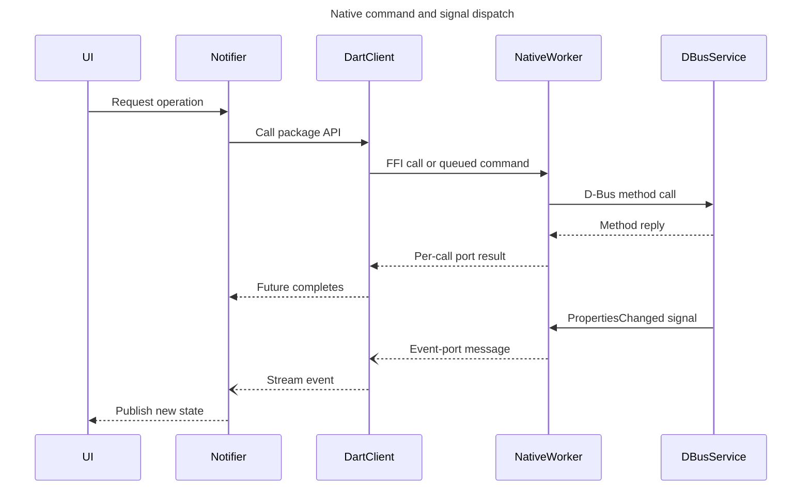

# Native Bluetooth ownership, lifetime, threads, and signal dispatch

## Purpose

This document explains how these application components are structured:

- `BluetoothNotifier`
- `BluetoothMediaNotifier`
- `NativeObexBackend`
- `NativeTelephonyBackend`

It focuses on ownership, lifetime, native threads, Dart event dispatch, D-Bus
signals, command replies, and shutdown ordering. API coverage and functional
flows are documented in:

- [Native Bluetooth libraries: API and architecture report](native_bluetooth_libraries_architecture.md)
- [Native Bluetooth process flows and expected behavior](native_bluetooth_process_flows.md)

The descriptions below apply to the package versions resolved in this checkout
on 2026-11-01. Native implementation details can change between package
versions even when the Dart API remains compatible.

## Short answer

The four application components do not create Dart isolates or Flutter UI
threads. They run on the application's existing Dart isolate and use `Future`,
`Stream`, `ReceivePort`, timers, and Riverpod state.

The native libraries create their own C++ execution resources where required:

| Component | Native client | Native execution model | Dart delivery model |
| --- | --- | --- | --- |
| `BluetoothNotifier` | `BlueZClient` | One dedicated BlueZ D-Bus event-loop thread per client | Native typed messages → `ReceivePort` → package object caches → asynchronous broadcast streams → notifier |
| `BluetoothMediaNotifier` | `BluezMediaClient` | Package-managed D-Bus event loop, per-client operation worker, per-client cover-art worker, plus process-level connection/reaper workers | Native typed messages → `ReceivePort` → media proxy caches → asynchronous broadcast streams → notifier |
| `NativeObexBackend` | `BlueZObexClient` | One dedicated OBEX D-Bus event-loop thread per client; most ordinary FFI method calls are synchronous at the native boundary | Native typed messages → `ReceivePort` → asynchronous OBEX event stream → `PhoneDataNotifier` |
| `NativeTelephonyBackend` | `PipeWireTelephonyClient` | One owner thread per client polls the D-Bus file descriptors and a native command queue | Native JSON bytes → `ReceivePort` → synchronous client streams → synchronous backend snapshot stream → `CallStateNotifier` |

“Synchronous stream” here means listeners run immediately on the same Dart
isolate call stack that adds the event. It does not mean they run on the native
thread.

## Shared signal-dispatch structure

```mermaid
flowchart LR
  subgraph nativeService [System service]
    dbusService[D-Bus service]
  end

  subgraph nativeLibrary [Native library]
    eventLoop[Native event loop]
    objectCache[Native object cache]
    dartPost[Dart PostCObject]
  end

  subgraph dartPackage [Dart package]
    receivePort[ReceivePort]
    decoder[Event decoder]
    proxyCache[Dart proxy cache]
    streams[Package streams]
  end

  subgraph application [Application]
    adapter[Notifier or backend]
    state[Riverpod state]
    ui[Flutter UI]
  end

  dbusService -->|Signal| eventLoop
  eventLoop -->|Update| objectCache
  objectCache -->|Encoded event| dartPost
  dartPost -.->|Port message| receivePort
  receivePort --> decoder
  decoder --> proxyCache
  proxyCache --> streams
  streams --> adapter
  adapter --> state
  state --> ui
```



The dotted edge is the thread boundary. `Dart_PostCObject_DL` copies or posts a
message to a Dart native port. The Dart VM later schedules the corresponding
`ReceivePort` listener on the owning Dart isolate. Native code does not call a
Riverpod notifier or Flutter widget directly.

## Command and signal sequence



The command reply and later property signal are separate events. A successful
method reply means the service accepted the operation; authoritative UI state
normally comes from the subsequent object/property signal or an explicit
refresh.

## Ownership hierarchy

| Owner | Owned resources | Lifetime |
| --- | --- | --- |
| Riverpod provider container | `BluetoothNotifier`, `BluetoothMediaNotifier`, `PhoneDataNotifier`, and `CallStateNotifier` | Normally the homescreen process/provider-container lifetime because these use `NotifierProvider`, not `AutoDisposeNotifierProvider` |
| `BluetoothNotifier` | One `BlueZClient`, five package stream subscriptions, device caches, connection-policy sets, scan timer, agent registration | Created when `bluetoothProvider` is first built; remains active until provider/container disposal |
| `BluetoothMediaNotifier` | Zero or one `BluezMediaClient`, client/object subscriptions, retry and position timers, player/transport references, temporary cover-art directory | Created when `bluetoothMediaProvider` is first built; client can be replaced after initialization failure; notifier lives until provider/container disposal |
| `PhoneDataNotifier` | Zero or one `NativeObexBackend`, its event subscription, per-phone generation, temporary transfer directory, persistent contact-store coordination | Provider lifetime, but the backend is phone-session scoped and replaced on address/session changes |
| `NativeObexBackend` | One `BlueZObexClient`, optional PBAP session, optional MAP session, one Dart session-bus client for the compatibility MAP call, MAP-operation queue | From `open(address)` until `close()`, phone switch, service loss, retry, or provider disposal |
| `CallStateNotifier` | Zero or one `NativeTelephonyBackend`, snapshot subscription, phone generation, duration timer, transport-activation state | Provider lifetime, but the backend is phone-session scoped and replaced when the selected address changes |
| `NativeTelephonyBackend` | One `PipeWireTelephonyClient`, seven client subscriptions, current immutable snapshot, one snapshot stream controller | From construction for one phone address until `close()`; closed instances are not reused |

## 1. `BluetoothNotifier`

### Structure and ownership

`BluetoothNotifier` is the application policy owner for the base Bluetooth
connection. Its `build()` method:

1. Creates one `BlueZClient` through `blueZClientFactoryProvider`.
2. registers `_disposeResources()` with `ref.onDispose()`.
3. schedules `connect()` in a microtask so initial Riverpod state can be
   returned before native initialization completes.

The notifier owns its `BlueZClient`. Widgets do not hold or close the client.
They call notifier methods and observe `BluetoothState`.

Profile-specific A2DP, AVRCP, and HFP requests use the selected
`BlueZDevice.connectProfile()` proxy owned by `BlueZClient`; there is no
separate Dart D-Bus client for HFP.

### Native thread and signal dispatcher

`BlueZClient.connect()` creates a Dart `ReceivePort` and passes its native port
ID into the native client constructor. The native client owns:

- one system-bus connection;
- one object manager;
- an optional pairing agent;
- one dedicated C++ `std::thread` running the D-Bus event loop;
- a registry token used instead of exposing the native context address.

The native object manager subscribes to ObjectManager and property signals.
Pairing-agent calls also arrive on the native D-Bus event loop. Native code
encodes each event as typed bytes and posts it with `Dart_PostCObject_DL`.

On the Dart isolate:

1. `BlueZClient._onEvent()` receives the bytes.
2. `_dispatchEvent()` decodes the discriminator and payload.
3. It updates cached `BlueZAdapter` or `BlueZDevice` proxies.
4. It adds the proxy to `deviceAdded`, `deviceRemoved`, `deviceChanged`,
   `adapterChanged`, or `agentRequest`.
5. Those package controllers are ordinary asynchronous broadcast streams, so
   notifier listeners run in a later Dart microtask/event turn.
6. `BluetoothNotifier` updates its maps and publishes `BluetoothState` on the
   same Dart isolate used by Flutter.

There is no lock around `BluetoothState`: Dart isolate serialization provides
the application-side ordering. Native caches and the native client registry
use their own C++ synchronization.

### Commands

Connect, disconnect, pair, and GATT operations use a per-call Dart result port.
The native side submits an asynchronous D-Bus call and posts success or error
to that port. Adapter property helpers include some direct FFI/native calls.
The notifier awaits the Dart `Future`, but connection truth is still confirmed
from the device's cached `Connected` property/event.

`connectProfile()` follows the same native per-call result-port path. The
notifier first establishes A2DP or AVRCP, then requests HFP independently.
Failure of the HFP result future is logged without discarding the established
base profile connection.

### Lifetime and shutdown

`BluetoothNotifier` is not recreated for each phone. It remains the long-lived
owner of the adapter and all known devices. A phone switch changes policy and
cached state, not the client lifetime.

On provider disposal it:

1. marks itself disposed so late handlers cannot publish state;
2. cancels the scan timer;
3. requests discovery stop when necessary;
4. cancels every Dart stream subscription;
5. unregisters the pairing agent;
6. calls `BlueZClient.close()`.

Native close removes the registry token first, asks the D-Bus loop to leave,
joins the native thread, and then releases the connection/context. A stale FFI
handle no longer resolves to a live context.

## 2. `BluetoothMediaNotifier`

### Structure and ownership

`BluetoothMediaNotifier` is independent of `BluetoothNotifier`. It does not own
pairing or the selected device. It continuously observes the BlueZ media object
tree and selects the most relevant player/transport.

Its `build()` method reads cover-art configuration, registers cleanup, starts
asynchronous initialization, and immediately returns empty media state. It owns:

- the current `BluezMediaClient`;
- subscriptions to client-level add/remove streams;
- per-player, transport, folder, and item property subscriptions;
- initialization, cover-art, and position timers;
- temporary cover-art files;
- command serialization for play/pause.

### Native threads and dispatchers

The media package has more native execution resources than the base BlueZ
client:

- a package-managed asynchronous system-bus event loop;
- a per-client operation queue with its own worker thread;
- a per-client cover-art queue with its own worker thread;
- process-level connection and reaper queues used for asynchronous creation and
  destruction;
- when cover-art support uses its session-bus service, that service starts its
  own asynchronous D-Bus event loop.

This separation prevents cover-art work or normal media commands from running
inside the Dart UI isolate and keeps lifecycle cleanup ordered. It also means
the exact thread count is an internal package detail rather than an application
contract.

BlueZ media signals are handled by the native media object manager. It updates
its object snapshot and posts tagged bytes to the client's Dart event port.
`BluezMediaClient._dispatchEvent()` then:

- creates or updates cached player, control, transport, folder, and item
  proxies;
- emits add/remove streams;
- invokes each proxy's `propertiesChanged` stream after property updates;
- invalidates and disposes proxies when their D-Bus interface disappears;
- reports BlueZ owner loss/restoration through service-availability events.

The media package's broadcast streams are asynchronous. Consequently,
`BluetoothMediaNotifier` callbacks run on the Dart isolate after the package
has updated its proxy cache.

### Commands and ordering

Each Dart media API call creates a per-operation `ReceivePort`. Native code
routes normal commands through the operation worker and artwork commands
through the cover-art worker, then posts a typed success, payload, or error
message to the result port.

At application level, rapid play/pause requests are additionally chained on
`_playbackCommands`. This is a Dart ordering policy, not another thread. Other
commands await their native result and refresh the selected player afterward.

### Lifetime and shutdown

The notifier normally owns one long-lived client. On initialization failure it
closes the partial client and creates a new one after backoff. This replacement
is internal to the notifier; widgets retain the same provider.

On disposal it first marks itself disposed, cancels timers and Dart
subscriptions, clears tracked objects, closes the client, and deletes temporary
artwork. Native close retires the client handle, stops/joins the operation
queues, releases file descriptors and cover-art state, and stops the native
D-Bus event loop. Late Dart messages are ignored because `_closed` or
`_disposed` is already true.

## 3. `NativeObexBackend`

### Structure and ownership

`NativeObexBackend` is not a Riverpod notifier and is not application-global.
`PhoneDataNotifier` creates one backend for the currently selected phone data
session. The backend adapts the package API into an interface that tests can
replace.

The ownership chain is:

```text
PhoneDataNotifier
└── NativeObexBackend
    ├── BlueZObexClient
    ├── PBAP BlueZObexSession, optional
    ├── MAP BlueZObexSession, optional
    └── Dart session-bus client for MAP ListMessages compatibility
```

`open(address)` always closes any previous resources first. It then connects
the OBEX client and creates PBAP and MAP sessions independently. Its generation
counter rejects a session that finishes opening after a close or phone switch.

### Native thread and signal dispatcher

The native OBEX client owns one session-bus connection and one dedicated C++
event-loop thread. Its object manager subscribes to:

- `InterfacesAdded`;
- `InterfacesRemoved`;
- `PropertiesChanged` under `/org/bluez/obex`.

The native object manager maintains a synchronized interface/property cache.
When a signal arrives, it applies valid changed fields, preserves or refreshes
invalidated properties, and posts session, transfer, phonebook, message, or
message-access bytes to Dart. Connection loss posts an error and stream-done
event.

The Dart package's local backend owns a `ReceivePort`, subscription, and
asynchronous broadcast `StreamController<BlueZObexEvent>`. It decodes each
native message and adds it to `BlueZObexClient.events`. `NativeObexBackend`
exposes that stream without another controller. `PhoneDataNotifier` owns the
final subscription and decides whether an event updates transfer progress or
triggers a message refresh.

### Commands and serialization

Unlike telephony, the OBEX package does not enqueue every method on a dedicated
native command worker. Many FFI entry points perform their local D-Bus method or
property call synchronously before returning bytes/status to Dart. The Dart
method may return a `Future`, but the immediate FFI portion can execute on the
calling Dart isolate. Long OBEX file movement itself is represented by a
`Transfer1` object and monitored asynchronously through signals/polling.

The application adds two ordering mechanisms:

- `PhoneDataNotifier._pbap` serializes phonebook/contact/history operations
  because they share selected PBAP folder state.
- `NativeObexBackend._mapOperations` serializes MAP folder changes and related
  operations because MAP has mutable current-folder state.

These are chained Dart futures, not threads.

The current MAP `ListMessages` compatibility call uses a separate Dart
`DBusClient.session()`. Its reply is decoded on the Dart side and does not pass
through the native OBEX event port. Native OBEX signals for the resulting
objects still arrive through `BlueZObexClient.events`.

### Lifetime and shutdown

The backend is scoped to one selected phone session. `PhoneDataNotifier`
replaces it when the address or “open session” state changes, when retrying, or
after service loss.

`NativeObexBackend.close()` increments its generation and clears public
references before awaiting cleanup. It removes the PBAP session, removes the
MAP session, disposes the native client, and closes the Dart compatibility bus.
The package closes its receive port and stream controller; native disposal asks
the D-Bus loop to leave and joins its thread. `PhoneDataNotifier` separately
cancels its event subscription and deletes its temporary transfer directory.

The ordering prevents a late session creation or transfer event from being
published for the next phone.

## 4. `NativeTelephonyBackend`

### Structure and ownership

`NativeTelephonyBackend` is also a phone-scoped adapter, not a global notifier.
`CallStateNotifier` creates it with one Bluetooth address. The backend owns one
`PipeWireTelephonyClient` and filters the client's complete discovery tree down
to the gateway whose normalized address matches that phone.

During `connect()` it subscribes to:

- client lifecycle changes;
- gateway added, removed, and changed events;
- call added, removed, and changed events.

Each subscribed lifecycle, gateway, or call event rebuilds a complete immutable
`TelephonySnapshot` from the client's current gateway/call cache. This reduces
seven low-level streams to one application-facing snapshot stream.

### Native owner thread and dispatcher

Each telephony client creates one native owner thread. That thread owns the
D-Bus connection, gateway/call/transport registries, pending request map, and
operation proxies. It uses `poll()` over:

- the D-Bus socket;
- the D-Bus event-loop wakeup descriptor;
- the package command-queue wakeup descriptor.

This is a combined dispatcher: one owner thread serializes command intake,
D-Bus events, request completion, and timeout expiry. Dart commands are encoded
and pushed into the native queue. The owner thread validates client generation,
object incarnation, interface, and per-gateway busy state before sending an
asynchronous D-Bus method call.

Native discovery and lifecycle events are encoded as bytes and posted to the
client event port. Command results are posted to a separate per-call result
port. If the telephony service owner changes, the thread fails pending
operations, invalidates discovered objects, emits unavailable, and stops.

### Dart dispatch and synchronous snapshots

`PipeWireTelephonyClient._onNativeEvent()` runs on the application's Dart
isolate. It decodes the event and mutates the Dart gateway/call/transport proxy
caches. Removed objects are marked invalid before removal events are emitted.
Object incarnation and client generation prevent an old path from accidentally
targeting a newly created object that reused the same path.

Unlike the other three package streams, telephony client controllers use
`broadcast(sync: true)`. `NativeTelephonyBackend` also exposes a synchronous
broadcast snapshot controller. Therefore this chain executes immediately on
the same Dart event turn:

```text
ReceivePort listener
→ PipeWireTelephonyClient cache update
→ client stream listener
→ NativeTelephonyBackend._emit()
→ CallStateNotifier snapshot listener
→ Riverpod state update
```

It is still entirely on the Dart isolate; no listener runs on the native owner
thread. Synchronous delivery ensures a snapshot reflects the cache mutation
before another Dart event can interleave.

### Current transport-notification gap

The resolved `PipeWireTelephonyClient` applies `transportAdded`,
`transportChanged`, and `transportRemoved` events to the gateway's transport
proxy, but it does not expose a top-level transport event stream and does not
emit `gatewayChanged` for those transport-only updates.

`NativeTelephonyBackend` therefore cannot subscribe directly to transport
events. A transport-only change becomes visible in an application snapshot
when another subscribed lifecycle/gateway/call event causes `_emit()`, or when
the backend is connected and explicitly emits after its initial refresh. This
is an observation limitation in the currently resolved package/backend pair;
it should not be described as immediate transport-snapshot dispatch.

### Commands and lifetime

`NativeTelephonyBackend` resolves the current gateway/call proxy immediately
before each command. A removed object produces `StateError` instead of sending
a stale path. The package also rejects stale generation/incarnation in native
code.

`CallStateNotifier` owns one backend for the currently connected phone. A phone
switch increments the notifier generation, clears command and duration state,
cancels the old snapshot subscription, closes the backend, and creates a new
backend. Late snapshots are rejected by the notifier generation check.

`NativeTelephonyBackend.close()` is idempotent. It marks the backend closed,
cancels all seven client subscriptions, closes the native client, then closes
the snapshot controller. Native close requests command-queue stop and joins the
owner thread. All discovered Dart proxies are invalidated as the client closes.

## Dispatcher comparison

| Question | Bluetooth | Media | OBEX | Telephony |
| --- | --- | --- | --- | --- |
| Application object global or phone-scoped? | Global notifier | Global notifier | Phone-scoped backend | Phone-scoped backend |
| Creates a Dart isolate? | No | No | No | No |
| Native event execution | Dedicated connection thread | Package async D-Bus loop | Dedicated connection thread | One owner poll thread |
| Native command execution | Async D-Bus callbacks for major operations; some direct helpers | Operation worker or cover-art worker | Mostly direct/synchronous FFI calls; transfers continue asynchronously | Native command queue on owner thread |
| Native-to-Dart channel | Shared client event port plus per-call result ports | Shared event port plus per-call result ports | Shared client event port | Shared event port plus per-call result ports |
| Dart package streams | Asynchronous broadcast | Asynchronous broadcast | Asynchronous broadcast | Synchronous broadcast |
| Application serialization | Busy state and connection policy | Play/pause future chain and busy flags | PBAP and MAP future chains plus generation | One notifier command at a time plus native per-gateway busy check |
| Stale-object defense | Registry token and disposed flag | Retired handle and disposed proxies | Registry token, backend/provider generations | Client generation, object incarnation, validity, and notifier generation |

## Shutdown ordering requirements

Correct shutdown order is important because native events may already be in
flight:

1. Mark the application owner disposed or increment its generation.
2. Stop accepting new commands and cancel application timers.
3. Cancel application subscriptions so no new state is derived.
4. Remove profile/session objects owned by the application where required.
5. Close or dispose the Dart package client.
6. Let the package stop and join native workers/event loops.
7. Close application stream controllers and delete temporary files.

Generation/disposed checks are required even with this ordering because a
message may have crossed the native-port boundary before shutdown began.

## Important boundaries

- A `ReceivePort` is a cross-thread message entry point, not a new isolate by
  itself.
- A Dart `Future` chain serializes asynchronous work but does not create a
  worker thread.
- A broadcast stream controls Dart listener delivery; it does not describe the
  native D-Bus thread.
- D-Bus method replies and property signals are distinct. UI state should be
  reconciled from object events or refresh results rather than optimistic
  assumptions alone.
- `NativeObexBackend` and `NativeTelephonyBackend` are replaceable adapters.
  Their owning Riverpod notifiers enforce phone selection and stale-result
  policy.
- The raw Dart D-Bus compatibility calls are separate from the native clients'
  `ReceivePort` dispatch pipelines.
