# Native Bluetooth process flows and expected behavior

## Scope

This document defines the runtime process and expected application behavior for
each native Bluetooth library used by the AGL homescreen:

- `bluez_native`
- `bluez_media_native`
- `bluez_obex_native`
- `pipewire_telephony_native`

The flowcharts describe the current production implementation. Library APIs and
ownership boundaries are documented separately in
[Native Bluetooth libraries: API and architecture report](native_bluetooth_libraries_architecture.md).

## Shared process rules

| Situation | Expected behavior |
| --- | --- |
| Selected phone changes | Increment the owning provider's generation, dispose the old native client, reject stale asynchronous results, and publish data only for the newly selected address. |
| Bluetooth phone disconnects | Close OBEX and telephony clients, stop transient timers, clear live state, and retain only the persistent per-phone contact cache. |
| One profile fails | Keep unrelated profiles running. MAP failure must not disconnect PBAP, media, HFP, or the base Bluetooth connection. |
| Native object disappears | Treat its cached proxy or object path as invalid and wait for a new discovery event. Do not issue commands through stale objects. |
| Provider is disposed | Cancel subscriptions before closing the native client and do not publish any later event or command result. |
| User-visible data | Never substitute sample contacts, calls, history, messages, or media data in production. |

## 1. `bluez_native` process

### Device discovery, pairing, and connection flow

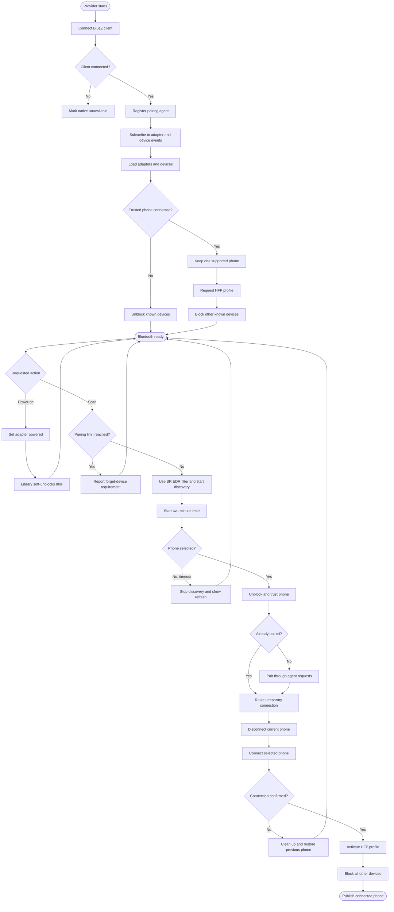

### Signal and data-exchange sequence

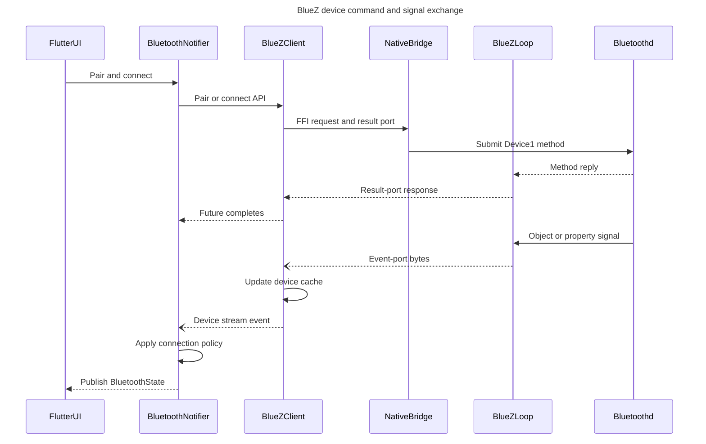

The method reply completes the requested command. The later object/property
signal updates the authoritative cached device state and drives the UI. Pairing
agent requests use the same native event port and are emitted through the
separate `agentRequest` stream.

#### Pairing, authorization, rejection, and cancellation

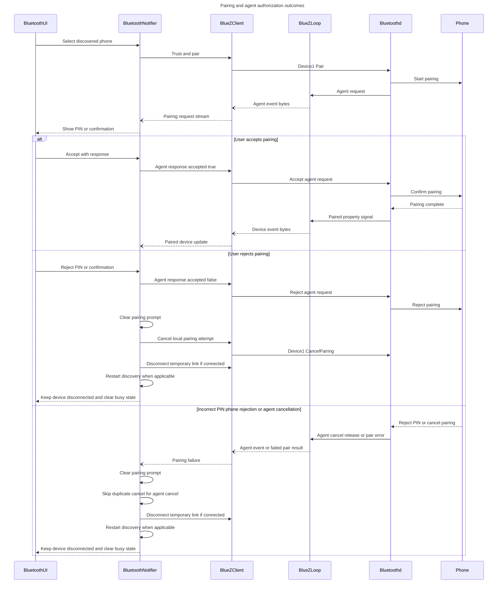

When the user presses reject, `agentRespond(accepted: false)` is sent for an
agent request that needs a response. Cleanup then attempts `CancelPairing` and
disconnects any temporary connection. When BlueZ itself sends `cancel` or
`release`, cleanup skips a second cancellation call. An incorrect PIN or a
phone-side rejection reaches the same failed `pair()` or agent-cancel path.
Cleanup is best effort: cancellation or disconnection errors are logged and do
not prevent the prompt from being cleared or discovery from restarting. The
current implementation does **not** automatically remove the device from
BlueZ's paired-device list.

#### First device connection

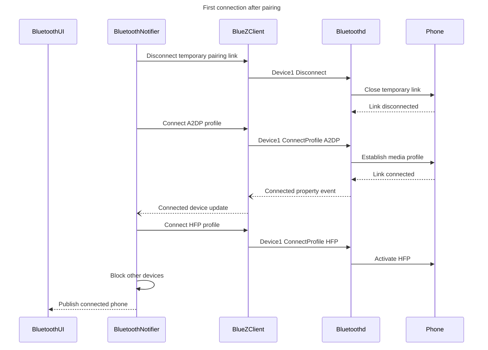

#### First-connection failure before the base link is established

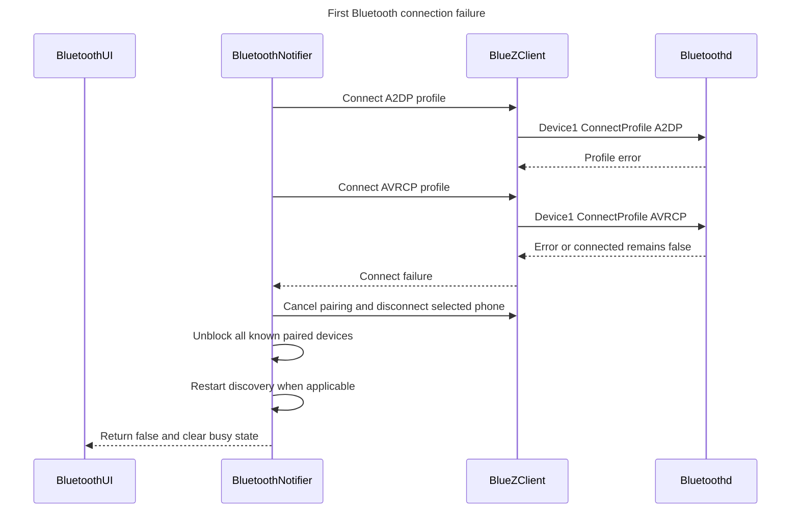

When this is the first phone, there is no previous device to restore, so the
notifier attempts to unblock all known paired devices. The separate switching
failure sequence below covers rollback when another phone was connected.

#### HFP backend unavailable after the base profile connects

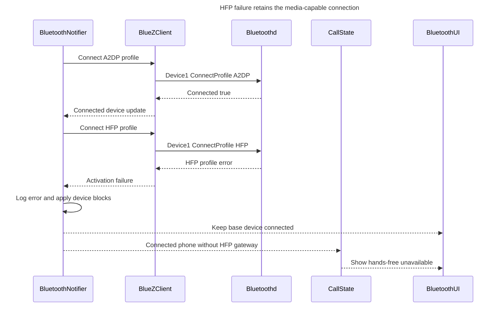

The notifier no longer uses the all-profile `Device1.Connect()` path for a
phone that advertises media. It establishes A2DP first and tries AVRCP if A2DP
fails, waiting for authoritative `Connected=true`. HFP is then requested as a
separate best-effort profile. Its failure is logged without cleaning up the
already established base connection, so media and OBEX remain available.

#### Device disconnect

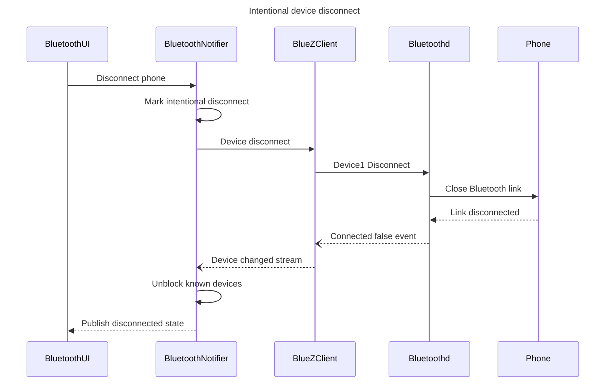

#### Switch connected device

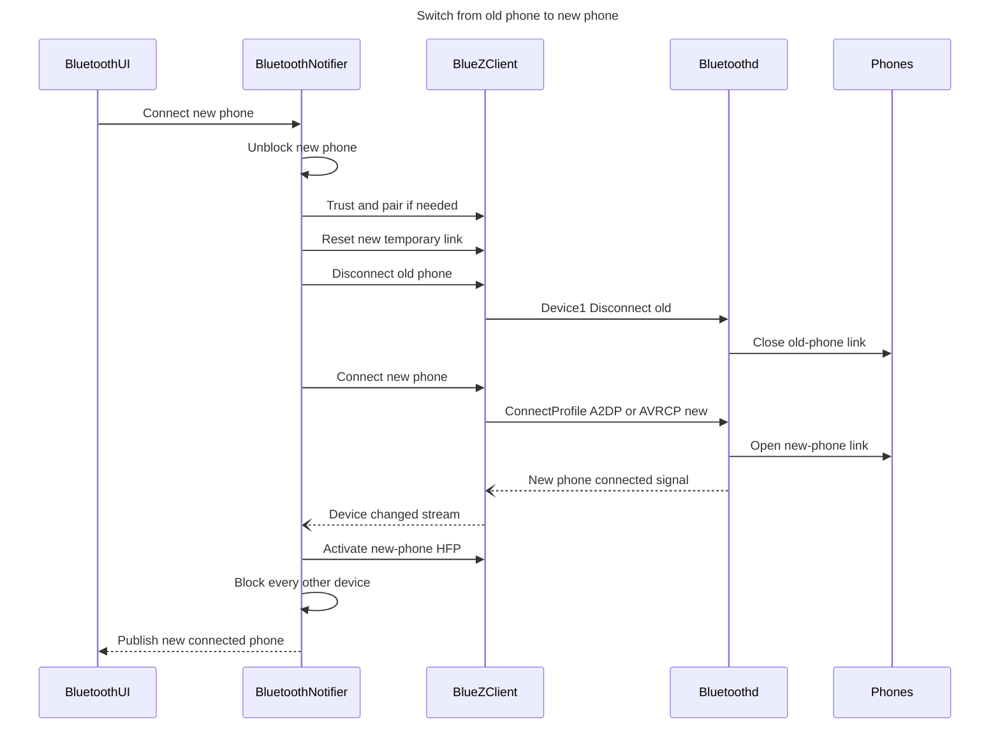

#### Device-switch failure and rollback

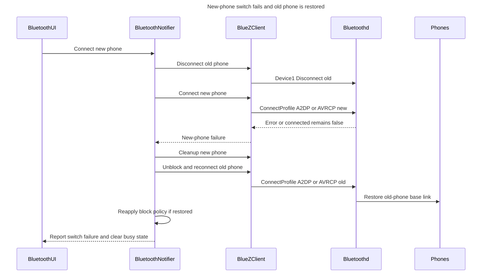

Rollback is best effort. If the old phone cannot be restored, every known
paired device is unblocked so a later manual or remote connection is possible.
The attempted new phone remains disconnected; discovery restarts only when the
operation did not already leave the scan page. The current rollback path does
not explicitly call `_ensureHandsFreeProfile()` for the restored old phone.

### Expected behavior

| Process area | Expected behavior |
| --- | --- |
| Startup | Call `BlueZClient.connect()`, wait for the initial snapshot, register the custom pairing agent, subscribe to device/adapter events, then publish `nativeAvailable: true`. |
| Startup failure | Publish `nativeAvailable: false`, keep the UI usable, and report Bluetooth as unavailable without crashing the app. |
| Adapter power-on | Call `BlueZAdapter.setPowered(true)`. The library attempts `rfkill unblock bluetooth`; the application must not run a duplicate rfkill command. |
| Adapter power-off | Stop discovery first, power off the adapter, clear busy and pairing state, and show scanning as stopped. |
| Scan entry | Start only on the scan screen, power on the adapter if required, apply the BR/EDR discovery filter, and make repeated entry calls idempotent. |
| Scan timeout | Stop discovery after two minutes and expose a refresh action. Leaving the scan page also stops discovery but is not reported as a timeout. |
| Pairing limit | Refuse a new unpaired phone after ten paired devices and ask the user to forget one first. |
| Supported-device filter | Accept devices advertising A2DP, AVRCP, HFP, PBAP, or MAP, or devices matching the smartphone class mask. Reject unsupported new devices. |
| Pairing agent | Surface PIN, passkey, and confirmation requests only during an intentional scan/connect operation. Reject unsolicited pairing requests. |
| Service authorization | Accept authorization for the phone currently being connected. Also allow a paired and trusted supported phone to restore HFP when no other phone is connected. |
| External connection | Reject an unknown, untrusted, unsupported, or second connected phone. Outside the Bluetooth screens, reject unsolicited connections except the trusted HFP restoration case. |
| Pair and connect | Unblock the selected phone, trust it, pair if required, reset any temporary pairing link, disconnect the old phone, and then perform one explicit connection sequence. |
| Connection confirmation | Treat the operation as successful only when `device.connected` becomes true. Publish connection state after the policy operations complete. |
| Base connection | For a phone advertising media profiles, request A2DP Source first and AVRCP as fallback through native `BlueZDevice.connectProfile()`. Wait up to ten seconds for authoritative `Connected=true`. Use general `connect()` only when neither media UUID is advertised. |
| HFP activation | After the base profile connects, request the HFP Audio Gateway separately through native `BlueZDevice.connectProfile()`. `AlreadyConnected` is success. |
| One-phone policy | Keep one supported phone connected and set `Device1.Blocked` on the other known devices. Unblock all devices when no phone is connected. |
| Pairing rejection | Send a negative agent response when required, clear the prompt, cancel pairing unless BlueZ already cancelled it, disconnect any temporary link, and restart discovery on the scan page. Cleanup errors are logged. |
| Pairing/connect failure | Clear the pairing prompt, cancel pairing when appropriate, disconnect the failed phone, unblock devices, restart discovery when applicable, and make a best-effort reconnection to the previous phone. The code does not automatically remove the device from BlueZ. |
| HFP activation failure | Log the HFP-specific error and retain the A2DP/AVRCP-established connection. Media and OBEX continue; telephony reports hands-free unavailable. |
| Saved-device connection with HFP unavailable | Reconnect A2DP or AVRCP without invoking all auto-connect profiles, then attempt HFP independently. HFP availability must not decide base connection success. |
| Switch rollback | If the new phone fails after the old phone was disconnected, unblock and reconnect the old phone and reapply blocking when it reconnects. If rollback fails, log it and unblock all devices. The rollback path does not explicitly reconnect HFP. |
| Disconnect | Disconnect intentionally, suppress external-disconnect handling for that event, unblock all known devices, and publish the new device state. |
| Forget device | Disconnect it if necessary, remove it through the adapter, update the device list, and reapply the one-phone block policy. |
| Event handling | Update cached device objects and UI state from add, remove, change, adapter, and agent streams. A BlueZ event must not mutate state after provider disposal. |
| Cleanup | Cancel scan timers and all stream subscriptions, unregister the agent if registered, and close the `BlueZClient`. |

## 2. `bluez_media_native` process

### Media discovery and control flow

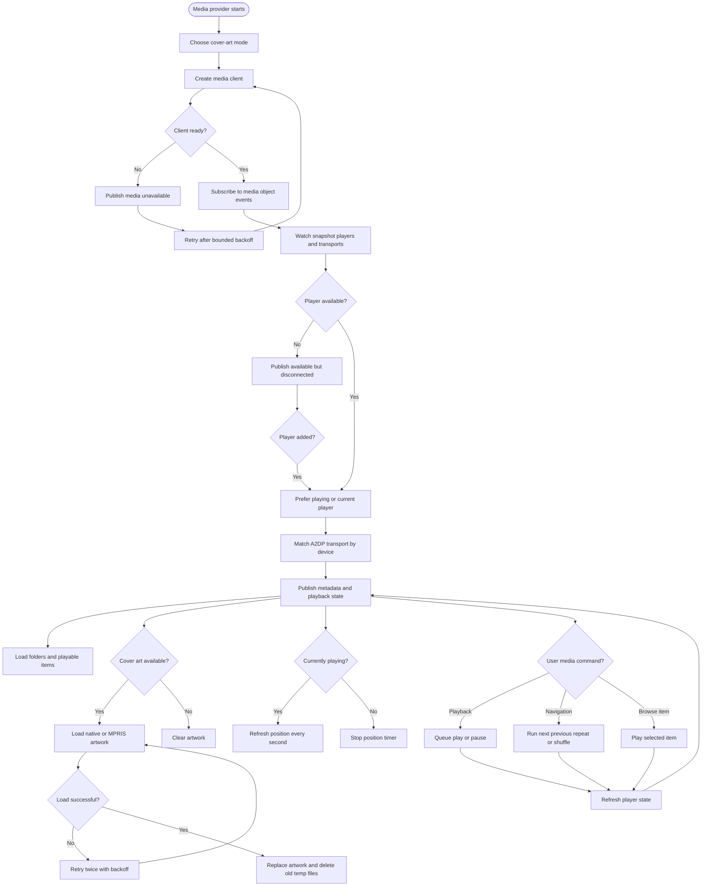

### Signal and data-exchange sequence

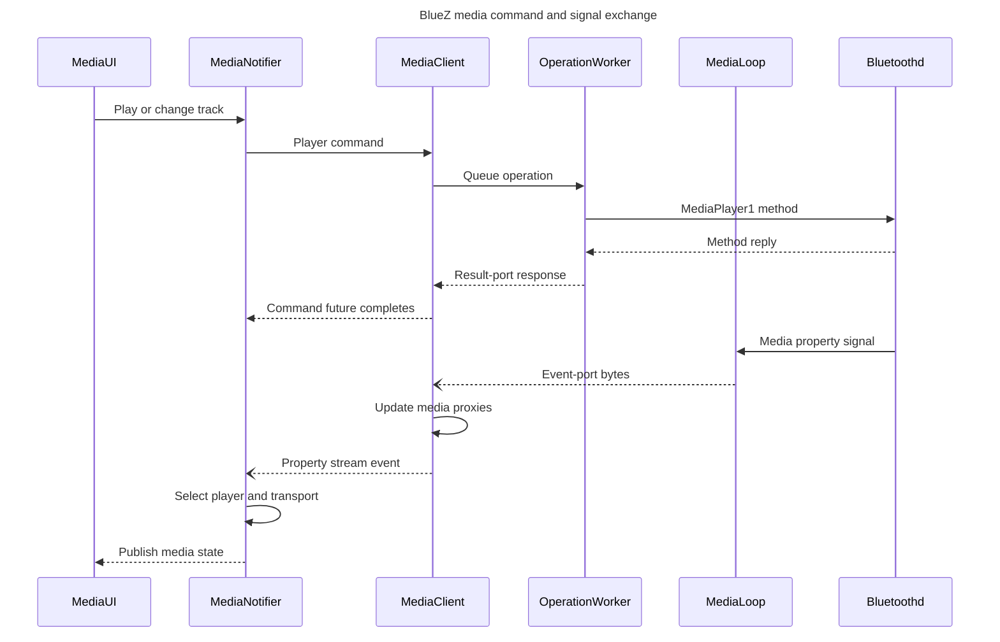

Normal commands and cover-art commands use different native worker queues.
Both return through per-call result ports. Media object additions, removals, and
property changes use the shared event port and update package proxies before
the notifier receives a stream event.

#### Native cover-art fetch

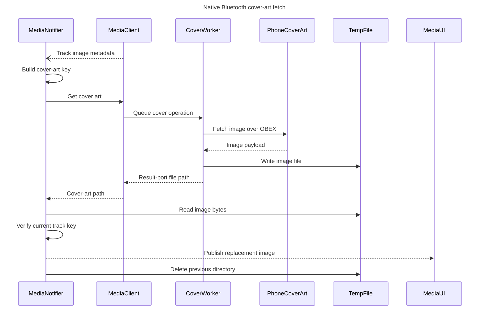

#### MPRIS cover-art fetch

MPRIS cover-art handling is selected by configuration; it is not enabled by a
separate runtime call. The application reads
`bluetooth.enable-cover-art-native` from its configuration:

- missing or `false`: create `BluezMediaClient` with
  `BluezMediaCoverArtMode.mpris`;
- `true`: create it with `BluezMediaCoverArtMode.native`.

Therefore MPRIS is the current default and setting the flag enables the native
OBEX cover-art path instead.

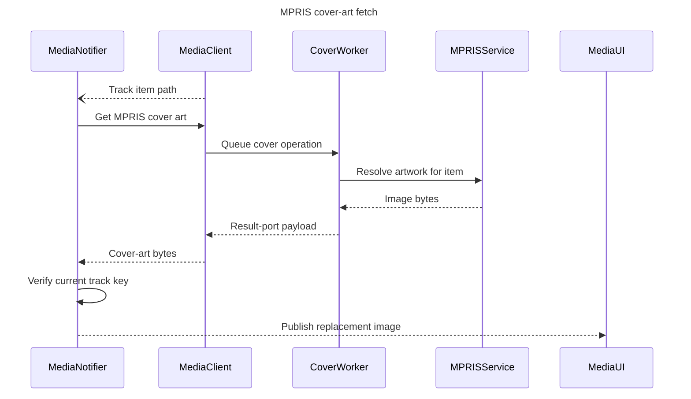

#### MPRIS fallback and retry

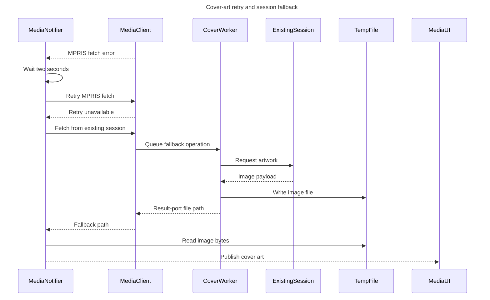

### Expected behavior

| Process area | Expected behavior |
| --- | --- |
| Cover-art configuration | Read `bluetooth.enable-cover-art-native`. Missing or `false` selects MPRIS; `true` selects the native OBEX cover-art implementation. This choice is fixed when the notifier builds. |
| Startup | Create `BluezMediaClient` with the configured cover-art mode and wait for the initial object snapshot. |
| Startup failure and retry | Clear subscriptions, close any partly created client, publish media unavailable, and retry after 2, 4, 8, 16, then 30 seconds maximum between attempts. |
| Object discovery | Subscribe to player, transport, folder, and item add/remove events and to each object's `propertiesChanged` stream. Include objects already present in the initial snapshot. |
| Player selection | Prefer a player whose status is `playing`, otherwise retain the current player if it still exists, otherwise select the first player. |
| Transport selection | Consider A2DP transports belonging to the selected player's device. Prefer an active transport, then the current transport, then the first matching transport. An idle transport still means media is connected. |
| No player | Publish an available but disconnected/empty media state, stop position updates, clear browsing state, cancel cover-art retry work, and remove temporary artwork. |
| Metadata | Publish title, artist, album, duration, position, playback status, shuffle, repeat, and the current item path from player properties. |
| Position updates | While connected and playing, refresh the player once per second. Prevent overlapping refresh calls and stop the timer when playback stops or the player disappears. |
| Browsing | List folders belonging to the selected player, watch returned items, expose only playable items with non-empty titles, and retry an item/folder refresh up to two times. |
| Player change | Clear listed-folder and refreshed-item tracking, load the new player's folders, and rebuild the item list. |
| Cover-art eligibility | Native mode requires an OBEX port plus an image handle or item path. MPRIS mode requires an item path. |
| Cover-art replacement | Keep the current image visible until the replacement loads successfully. Ignore results belonging to an old track or disposed provider. |
| Cover-art retry | In MPRIS mode, retry publication retrieval before using an existing session fallback. For a failed final artwork load, retry twice with 2-second then 4-second delays. |
| Temporary files | Store artwork in a unique temporary directory, delete the previous directory after replacement, and delete all remaining artwork on player removal or disposal. |
| Play and pause | Update the UI optimistically, serialize rapid play/pause requests, execute them against the selected player, then refresh authoritative player state. |
| Other commands | Execute next, previous, repeat, shuffle, and selected-item playback only when a player exists. Refresh after completion and log command errors without terminating media observation. |
| Removed object | Cancel its property subscription, remove its cached browsing state, and recompute media or item state from the remaining objects. |
| Cleanup | Stop all retry and position timers, cancel object/client subscriptions, clear caches, close the native client, and delete temporary artwork. |

## 3. `bluez_obex_native` process

### PBAP, MAP, and transfer flow

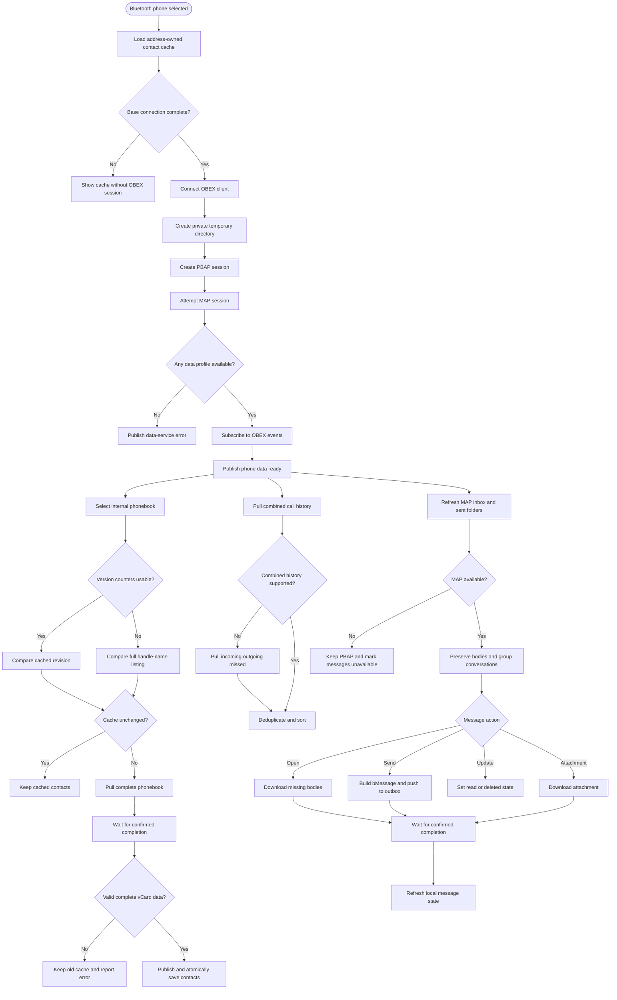

### Signal and data-exchange sequence

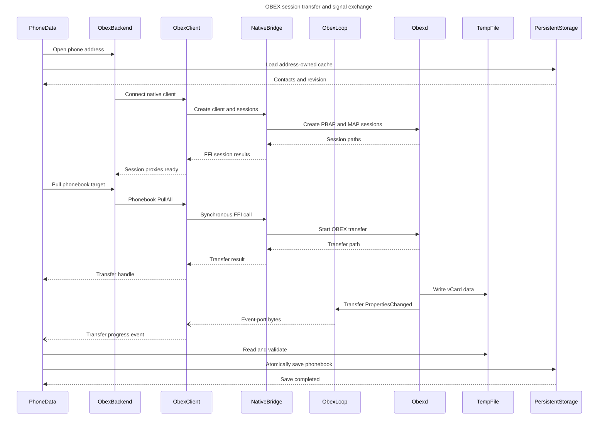

Session and operation calls return their immediate D-Bus result through FFI.
The actual file transfer continues in `obexd`; progress and terminal state
arrive later through the native event port. `PhoneDataNotifier` publishes new
persistent data only after an explicit completed transfer and file validation.
`PersistentStorage` is the address-owned `ContactStore`. It is read before the
live OBEX session opens, and it is updated only after a replacement phonebook
has completed and passed validation. A storage failure leaves the contacts
usable in memory.

### Expected behavior

| Process area | Expected behavior |
| --- | --- |
| Selection while connecting | Load contacts cached for the selected address immediately, but do not open PBAP/MAP during the temporary pairing connection. |
| Session startup | After the base Bluetooth connection settles, connect `BlueZObexClient`, create a temporary working directory, then create independent PBAP and MAP sessions. |
| Partial profile availability | Continue with PBAP when MAP creation fails, or with MAP when PBAP is unavailable. Fail startup only when neither usable session can be established. |
| Startup timeout | Treat an OBEX open operation longer than 15 seconds as an error, close partial sessions, and expose retry. |
| Cached contacts | Load only the cache owned by the normalized selected Bluetooth address. Never display another phone's contacts while switching. A damaged cache is ignored so a fresh transfer can proceed. |
| Contact revision check | Prefer PBAP database identifier and primary/secondary counters. When unavailable, compare phonebook size plus a complete sorted handle/name listing. |
| Cache limitation | A fallback handle/name listing cannot detect number or photo edits under an unchanged handle; explicit refresh forces a full download. |
| Contact download | Select `int/pb`, request vCard 3.0 fields for names, numbers, UID, and photo, wait for confirmed completion, validate the vCard payload, then publish it. |
| Contact failure | Keep the previous usable contacts, mark PBAP unavailable, and report a contacts-specific error. |
| Contact persistence | Save per-phone contacts atomically. If saving fails, keep the newly loaded contacts in memory and report that persistence failed. |
| PBAP serialization | Serialize contact and call-history operations because they change the selected phonebook on the shared PBAP session. |
| Call history | Try combined call history first. If unsupported, pull incoming, outgoing, and missed histories separately, deduplicate by ID, and sort newest first. |
| MAP refresh | Confirm message access, query filter fields, tolerate unsupported `UpdateInbox`, list inbox and sent folders, and group messages into conversations. |
| MAP failure | Set MAP unavailable and report a message-specific error without clearing PBAP contacts or closing the Bluetooth connection. |
| Native MAP events | Refresh conversations silently after message or message-access events, but do not start a second refresh while one is already active. |
| Open conversation | Download only message bodies not already cached in memory. Stop immediately if the phone generation changes. |
| Send message | Reject empty text or duplicate in-flight sends, build a temporary bMessage, push it to `telecom/msg/outbox`, wait for completion, then silently refresh conversations. |
| Message state | Apply read/deleted changes to the remote message first, then update local conversation state only if the same phone session is still current. |
| Attachments | Download to the current session's temporary directory, wait for confirmed completion, then attach the local path to the message model. |
| Transfer state | Record active, suspended, complete, and failed progress. Support pause, resume, and cancel through the native transfer object. |
| Transfer success | Accept success only from an explicit `complete` result/property/event. A vanished Transfer1 object is not success unless a previously observed completion proves it. |
| Transfer failure and timeout | Throw on `error`; poll active transfers; cancel after timeout; retain old persistent data when a replacement transfer is incomplete. |
| Service loss | Clear the live phone-data session, remove only this application's sessions, delete its temporary directory, and show `Bluetooth data service disconnected`. |
| Phone switch and stale work | Increment the generation and ignore every old session event, file result, cache result, or transfer completion. |
| Cleanup | Cancel the event subscription, remove PBAP and MAP sessions, dispose the OBEX client, close the compatibility session bus, and recursively delete the session's temporary directory. |

## 4. `pipewire_telephony_native` process

### HFP call and SCO transport flow

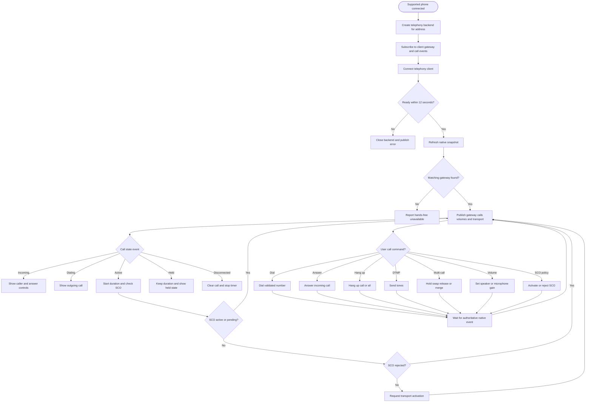

### Signal and data-exchange sequence

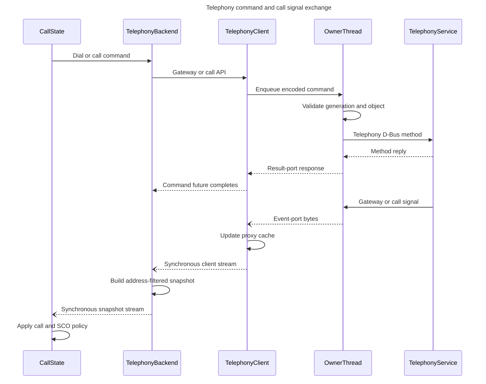

The native owner thread serializes its command queue with D-Bus event
processing. Dart client streams and backend snapshot streams are synchronous,
but they execute on the Dart isolate after the event-port message arrives, not
on the native owner thread.

#### Telephony service disabled, inactive, or masked

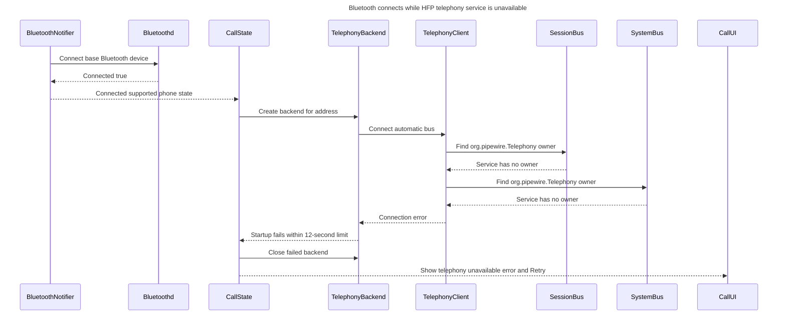

The application providers are independent. A masked and inactive
`wireplumber@bluetooth.service` cannot publish the PipeWire telephony gateway,
call, or SCO objects expected by `pipewire_telephony_native`. The application
establishes A2DP or AVRCP before trying HFP, so the phone remains connected for
media and OBEX when the HFP-specific request fails.

There are two remaining HFP failure points:

1. BlueZ may reject the HFP-specific `Device1.ConnectProfile` because no usable
   backend is available. `BluetoothNotifier` logs this while retaining the
   separately established A2DP/AVRCP connection.
2. BlueZ may accept the profile while `org.pipewire.Telephony` is missing or
   exposes no gateway for the phone. The telephony backend then fails to start,
   or the notifier publishes the more specific hands-free-unavailable message.

Starting the external service later does not by itself schedule a reconnect in
`CallStateNotifier`. The user must select **Retry**, or the Bluetooth address
must disconnect/change and reconnect. A masked systemd unit must first be
unmasked by the platform/service owner before it can be started. The historical
WirePlumber log about oFono means oFono was running without being selected as
the HFP/HSP backend and could interfere; the current decisive condition in the
provided status is that the Bluetooth WirePlumber unit is masked and inactive.

#### Incoming call from the phone

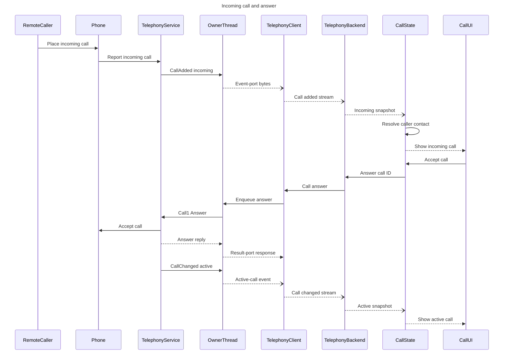

#### Outgoing call started from the Flutter UI

```mermaid
sequenceDiagram
  title Outgoing call from Flutter UI
  participant DialerUI
  participant CallState
  participant TelephonyBackend
  participant TelephonyClient
  participant OwnerThread
  participant TelephonyService
  participant Phone
  participant Network

  DialerUI->>CallState: Dial number
  CallState->>CallState: Resolve contact name
  CallState->>TelephonyBackend: Dial address and number
  TelephonyBackend->>TelephonyClient: Gateway dial
  TelephonyClient->>OwnerThread: Enqueue dial command
  OwnerThread->>TelephonyService: AudioGateway1 Dial
  TelephonyService->>Phone: Dial number
  Phone->>Network: Start outgoing call
  TelephonyService-->>OwnerThread: Method reply
  OwnerThread-->>TelephonyClient: Result-port response
  TelephonyService->>OwnerThread: CallAdded dialing
  OwnerThread--)TelephonyClient: Dialing event bytes
  TelephonyClient--)TelephonyBackend: Call added stream
  TelephonyBackend--)CallState: Dialing snapshot
  CallState-->>DialerUI: Show outgoing call
  Network-->>Phone: Remote party answers
  Phone->>TelephonyService: Report active call
  TelephonyService->>OwnerThread: CallChanged active
  OwnerThread--)TelephonyClient: Active event bytes
  TelephonyClient--)TelephonyBackend: Call changed stream
  TelephonyBackend--)CallState: Active snapshot
```

#### Outgoing call started on the phone

```mermaid
sequenceDiagram
  title Phone-originated outgoing call
  participant PhoneUI
  participant Phone
  participant Network
  participant TelephonyService
  participant OwnerThread
  participant TelephonyClient
  participant TelephonyBackend
  participant CallState
  participant CallUI

  PhoneUI->>Phone: Dial number
  Phone->>Network: Start outgoing call
  Phone->>TelephonyService: Report dialing call
  TelephonyService->>OwnerThread: CallAdded dialing
  OwnerThread--)TelephonyClient: Event-port bytes
  TelephonyClient--)TelephonyBackend: Call added stream
  TelephonyBackend--)CallState: Dialing snapshot
  CallState-->>CallUI: Show phone-originated call
  Network-->>Phone: Remote party answers
  Phone->>TelephonyService: Report active call
  TelephonyService->>OwnerThread: CallChanged active
  OwnerThread--)TelephonyClient: Active event bytes
  TelephonyClient--)TelephonyBackend: Call changed stream
  TelephonyBackend--)CallState: Active snapshot
  CallState-->>CallUI: Show active call
```

#### SCO activation and audio state

```mermaid
sequenceDiagram
  title Automatic SCO transport activation
  participant TelephonyService
  participant OwnerThread
  participant TelephonyClient
  participant TelephonyBackend
  participant CallState
  participant Phone
  participant PipeWirePolicy

  TelephonyService->>OwnerThread: CallChanged active
  OwnerThread--)TelephonyClient: Active-call event
  TelephonyClient--)TelephonyBackend: Call changed stream
  TelephonyBackend--)CallState: Snapshot with idle SCO
  CallState->>CallState: Check active pending reject state
  CallState->>TelephonyBackend: Activate transport
  TelephonyBackend->>TelephonyClient: Transport activate
  TelephonyClient->>OwnerThread: Enqueue activate command
  OwnerThread->>TelephonyService: Transport1 Activate
  TelephonyService->>Phone: Establish SCO link
  Phone-->>TelephonyService: SCO connected
  TelephonyService-->>OwnerThread: Activation reply
  OwnerThread-->>TelephonyClient: Result-port response
  TelephonyService->>OwnerThread: TransportChanged active
  OwnerThread--)TelephonyClient: Transport event bytes
  TelephonyClient->>TelephonyClient: Update transport proxy
  TelephonyService->>PipeWirePolicy: Expose SCO audio nodes
  PipeWirePolicy->>PipeWirePolicy: Link microphone and speaker
```

Transport-only events currently update the client proxy without directly
triggering `NativeTelephonyBackend._emit()`. The next subscribed gateway/call
event republishes the cached active transport state. PipeWire policy, not the
Dart package, performs the final audio-node links.

#### Hangup from the Flutter UI

```mermaid
sequenceDiagram
  title Hangup requested by Flutter UI
  participant CallUI
  participant CallState
  participant TelephonyBackend
  participant TelephonyClient
  participant OwnerThread
  participant TelephonyService
  participant Phone

  CallUI->>CallState: End call
  CallState->>TelephonyBackend: Hang up active call
  TelephonyBackend->>TelephonyClient: Call hangup
  TelephonyClient->>OwnerThread: Enqueue hangup command
  OwnerThread->>TelephonyService: Call1 Hangup
  TelephonyService->>Phone: End call
  Phone-->>TelephonyService: Call ended
  TelephonyService-->>OwnerThread: Method reply
  OwnerThread-->>TelephonyClient: Result-port response
  TelephonyService->>OwnerThread: CallRemoved disconnected
  OwnerThread--)TelephonyClient: Removal event bytes
  TelephonyClient--)TelephonyBackend: Call removed stream
  TelephonyBackend--)CallState: Empty-call snapshot
  CallState->>CallState: Stop duration timer
  CallState-->>CallUI: Return to idle state
```

#### Hangup from the phone or remote party

```mermaid
sequenceDiagram
  title Phone or remote-party hangup
  participant RemoteParty
  participant Phone
  participant TelephonyService
  participant OwnerThread
  participant TelephonyClient
  participant TelephonyBackend
  participant CallState
  participant CallUI

  RemoteParty->>Phone: End active call
  Phone->>TelephonyService: Report disconnected call
  TelephonyService->>OwnerThread: CallRemoved disconnected
  OwnerThread--)TelephonyClient: Removal event bytes
  TelephonyClient->>TelephonyClient: Invalidate call proxy
  TelephonyClient--)TelephonyBackend: Call removed stream
  TelephonyBackend--)CallState: Empty-call snapshot
  CallState->>CallState: Clear call and timer
  CallState-->>CallUI: Return to idle state
```

The same signal path applies when the user ends the call directly from the
phone UI. No Flutter command is required; the application follows the native
call-removal event.

#### DTMF, volume, hold, swap, and conference controls

```mermaid
sequenceDiagram
  title In-call control command
  participant CallUI
  participant CallState
  participant TelephonyBackend
  participant TelephonyClient
  participant OwnerThread
  participant TelephonyService
  participant Phone

  CallUI->>CallState: Select in-call action
  CallState->>CallState: Validate participant state
  CallState->>TelephonyBackend: DTMF gain or multi-call command
  TelephonyBackend->>TelephonyClient: Gateway operation
  TelephonyClient->>OwnerThread: Enqueue validated command
  OwnerThread->>TelephonyService: Gateway D-Bus method
  TelephonyService->>Phone: Apply HFP command
  Phone-->>TelephonyService: Updated call or gain state
  TelephonyService-->>OwnerThread: Method reply
  OwnerThread-->>TelephonyClient: Result-port response
  TelephonyService->>OwnerThread: Property or call signal
  OwnerThread--)TelephonyClient: Event-port bytes
  TelephonyClient--)TelephonyBackend: Changed stream
  TelephonyBackend--)CallState: Updated snapshot
  CallState-->>CallUI: Refresh controls
```

### Expected behavior

| Process area | Expected behavior |
| --- | --- |
| Startup trigger | Create telephony only for a connected, supported phone whose Bluetooth connection operation is no longer busy. |
| Address isolation | Construct the backend for the selected address and expose only a gateway whose normalized address matches it. Ignore calls belonging to other gateways. |
| Startup | Subscribe before connecting, wait at most 12 seconds in the notifier, refresh the initial native snapshot, and publish ready state. |
| Missing HFP gateway | When the native client is ready but no matching gateway exists, report that hands-free calling is unavailable and instruct the user to reconnect in Bluetooth settings. |
| Startup/service failure | Close the backend, stop duration state, publish the cleaned error, and allow explicit retry for the current address. |
| Masked or inactive service | Expose no calls or SCO audio while retaining the independently established media-capable Bluetooth connection. Automatic bus selection tries the session bus and then the system bus; if neither owns `org.pipewire.Telephony`, close the failed backend and require explicit Retry after service recovery. |
| Snapshot updates | Rebuild state from subscribed client, gateway, and call events. Include call identity, number, name, multiparty flag, volumes, and the transport values currently cached on the matching gateway. |
| Transport-only signal limitation | The native client updates its transport proxy, but the resolved package exposes no top-level transport stream and does not emit `gatewayChanged` for a transport-only event. The backend publishes those new values when a later subscribed event causes `_emit()`. |
| Caller identity | Prefer the telephony-provided name, then the pending outgoing contact, then contacts belonging to the same phone address, then the number, then `Unknown caller`. |
| Primary call | Prioritize incoming, waiting, active, dialing, alerting, then held calls for the primary call surface while retaining all calls as participants. |
| Call duration | Start a one-second timer when the primary call becomes active. Preserve elapsed time while held and stop/reset it when the call disappears or changes. |
| Command serialization | Allow one telephony mutation at a time. Mark state busy, clear the previous error, and ignore another command until the current command completes. |
| Dial | Validate through the native gateway, remember the matching contact name for the outgoing transition, and wait for call discovery events to create authoritative call state. |
| Answer and reject | Answer the incoming call object. If a waiting call exists, hold the active call and answer the waiting call. Reject by hanging up the selected incoming call. |
| End call | Hang up the active call object when present; otherwise request `hangupAll` on the selected gateway. |
| DTMF | Send only native-supported DTMF characters through the selected gateway. Invalid input is reported as an operation error. |
| Multiple calls | Enable swap, release-and-answer, release-and-swap, hold-and-answer, and multiparty commands only when the current participant state allows them. |
| Volume range | Clamp application speaker and microphone requests to HFP gain range 0 through 15 before calling the backend. |
| Mute | Set microphone gain to zero and restore the last observed non-zero microphone gain when unmuting. |
| Speaker toggle | Set speaker gain to zero when disabled and restore the last observed non-zero speaker gain when enabled. This controls HFP gain, not PipeWire node linking. |
| Automatic SCO activation | When any call becomes active and the transport is neither active nor pending and `rejectSco` is not true, request transport activation. |
| SCO activation concurrency | Permit only one activation per phone generation. If another qualifying snapshot arrives during activation, perform at most one follow-up attempt after completion. |
| SCO rejection | Respect `rejectSco: true`; do not automatically activate that transport until policy changes. |
| Native object validity | Resolve the current gateway and call immediately before each command. Reject a command when the object was removed or belongs to an old client generation. |
| Command failure | Keep observing native state, clear busy state, and publish a user-readable error. A timed-out remote mutation has an unknown outcome, so refresh before retrying. |
| Phone switch | Increment generation, cancel the old snapshot subscription, close the old client, clear pending dial and duration state, then connect a backend for the new address. |
| Disconnect and cleanup | Cancel the duration timer and stream subscription, invalidate gateway/call/transport objects through client close, and return the UI to initial state. |
| Audio-routing boundary | `activate()` requests SCO transport activation. Platform PipeWire/WirePlumber policy remains responsible for linking microphone and speaker nodes. |

## Cross-library end-state expectations

| End state | `bluez_native` | `bluez_media_native` | `bluez_obex_native` | `pipewire_telephony_native` |
| --- | --- | --- | --- | --- |
| No Bluetooth adapter/service | Unavailable | Unavailable/retrying | Closed | Closed |
| Adapter on, no phone | Ready and unblocked | Available with no player | Closed with no live data | Initial with no gateway |
| Phone pairing in progress | Busy; agent prompts allowed | May remain empty | Address cache may load; sessions remain closed | Closed until connection settles |
| Connected media-only device | Connected | Player/transport available | Profiles may remain unavailable | No matching gateway |
| Connected phone with full profiles | One phone connected | Media active when exposed | PBAP/MAP ready | HFP gateway ready |
| MAP denied by phone | Connection retained | Unaffected | PBAP retained; messages unavailable | Unaffected |
| HFP gateway missing | A2DP/AVRCP connection retained | Available | Available when OBEX profiles are authorized | Clear hands-free error |
| Telephony service masked or inactive | A2DP/AVRCP connection retained | Available | Available when OBEX is authorized | No gateway, calls, or SCO; show error and allow Retry |
| Phone disconnects | Publish disconnected and unblock devices | Clear player when BlueZ removes it | Close sessions and temporary files | Close client and live calls |
| App/provider shutdown | Close client and agent | Close client and delete artwork | Remove owned sessions and dispose | Close client and invalidate proxies |

## Validation references

| Process | Main implementation | Primary automated coverage |
| --- | --- | --- |
| Device and pairing | `lib/data/data_providers/bluetooth_notifier.dart` | `test/bluetooth_profile_test.dart` covers the profile bridge; the full pairing policy still requires hardware validation |
| Media | `lib/data/data_providers/bluetooth_media_notifier.dart` | `test/media_restore_test.dart` covers media UI continuity; native object and command flows still require hardware validation |
| PBAP and MAP | `lib/data/data_providers/phone_data_notifier.dart`, `lib/data/services/obex_backend.dart` | `test/phone_data_notifier_test.dart`, `test/map_flow_test.dart` |
| HFP telephony | `lib/data/data_providers/call_notifier.dart`, `lib/data/services/telephony_backend.dart` | `test/telephony_flow_test.dart` |
