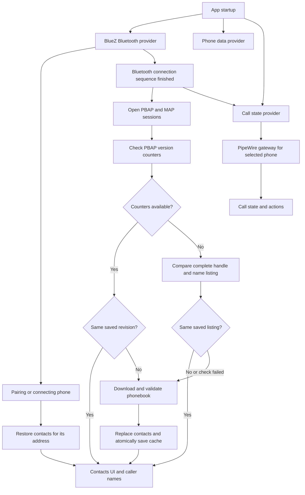

# Contact and telephony review

What this change does: The app now starts phone services at launch, restores
contacts for the selected phone, and checks for changes before downloading the
phonebook. Telephony remains a separate service bound to the same Bluetooth
address. This review assumes one homescreen process per Linux user, one active
phone, and the existing limit of ten paired devices.

## Architecture and flow

`BluetoothNotifier` owns pairing, connection, and adapter state.
`PhoneDataNotifier` owns OBEX sessions and synchronization.
`ContactStore` owns the per-phone persistent cache.
`CallStateNotifier` owns call state and actions; `NativeTelephonyBackend` selects
the PipeWire gateway and calls for the requested address. The UI observes these
providers and does not own their session lifetime.

Paired is not the same as connected. Cached contacts can be displayed while a
phone connects, but native profiles need a live link and the phone's sharing
permissions. The app waits through the temporary link established during
pairing, which the existing Bluetooth flow explicitly resets.

## Findings fixed

1. **Full contact download on every reconnect — fixed.**
   `refreshContacts()` previously fetched properties and size, discarded those
   results, and always called PullAll. It now compares a saved PBAP revision, or
   a complete listing when counters are unavailable, before downloading. A
   manual refresh still forces an update.

2. **Only the last phone was stored — fixed.**
   Each successful sync replaced the one cache entry, so returning to another
   paired phone lost its saved phonebook. The file now keeps independent
   entries by Bluetooth address and preserves the earlier file format during
   migration. Every cache lookup requires the owning phone's address; there is
   no fallback to another phone's last-used phonebook.

3. **Contact synchronization depended on opening a screen — fixed.**
   Riverpod providers initialize lazily. The app now initializes phone data and
   telephony explicitly at startup, so pairing and connection events trigger
   loading while another screen is visible.

4. **Old async work could update the next phone — fixed.**
   Connection state used to be reserved after asynchronous teardown, allowing
   repeated Bluetooth events to launch duplicate sessions. Transfers could
   later write into another phone's state or cache. The requested connection is
   now reserved immediately, lifecycle work is serialized, and async results
   are checked against the current connection generation. Saves use the
   captured phone address.

5. **Contact and recent-call requests could change each other's folder — fixed.**
   Automatic startup refreshes were sequential, but public refresh methods
   could still overlap. All PBAP operations now use one queue. Local contact
   search no longer sends a discarded remote search against whatever PBAP
   folder was most recently selected.

6. **Session cleanup could cancel other applications' transfers — fixed.**
   Cleanup previously iterated the global OBEX ObjectManager transfer list.
   It now removes only this app's sessions, which cancels their own transfers.
   A native session that finishes opening after cancellation is also removed.

7. **Failed sync or storage could appear successful — fixed.**
   A missing Transfer1 object was treated as completion, disk errors were only
   logged, and later profile refreshes could erase a contact error. Contact
   replacement now requires explicit transfer completion from a native event,
   the request's returned properties, or a successful status poll, plus a
   complete vCard envelope. Terminal event snapshots remain valid when BlueZ
   removes the transfer object before a later poll. Failures keep the prior
   cache; storage errors remain visible.

8. **Telephony could show a different gateway's calls — fixed.**
   The native backend previously picked the first gateway and collected calls
   from every gateway. It now selects by the requested Bluetooth address and
   includes only that gateway's valid calls. Stale snapshots and command results
   cannot update a newly selected phone, and service closure clears stale calls.
   Caller names are recomputed when contacts load.

9. **The last phone's contacts could appear without a selected device — fixed.**
   Startup no longer restores a global last-used phonebook. Contacts carry an
   explicit owner address, selecting another phone clears the old list
   immediately, and disconnecting clears the display while retaining each
   device's saved cache. Caller-name lookup rejects contacts belonging to a
   different phone, even when both phones contain the same number or contact ID.

## Verification and remaining limits

Focused tests cover persistence across restart, migration, file permissions,
concurrent saves, corrupted data, unchanged reconnects, changed revisions,
listing fallback, empty phonebooks, forced refresh, incomplete transfers,
failed profile access, phone switching, PBAP serialization, selected gateways,
caller names, service closure, and stale command completions. Existing phone,
media, and parser tests are also run.

Validation result: focused contact, telephony, and phone UI tests passed,
including startup without a selected phone, cache misses after switching,
wrong-owner cache rejection, and caller-name isolation. Analysis of the affected code and
tests reported only the existing `ProviderScope.parent` deprecation in
`lib/main.dart`; it reported no new errors or warnings.

PBAP listings contain only handles and names. On a phone without version
counters, a number/photo-only edit needs the Refresh contacts action. If both
revision and listing checks fail, the app downloads again rather than assuming
that an old cache is current. Recent calls and messages still refresh on
reconnect; only contacts use this persistent cache.

Saved phonebooks survive disconnects and unpairing; the file can be deleted to
clear them. Disk writes are coordinated inside one app process, not between
multiple homescreen instances sharing the same user directory.

Verdict: The reviewed reconnect and persistence paths are covered by automated
tests. Actual PBAP permissions, vendor counter behavior, HFP call control, and
SCO audio routing must still be checked on the AGL target with a real phone.

## Application call controls

The UI exposes Dial, Answer, Decline, End call, DTMF and microphone mute.
For a waiting call alongside an active or held call, the incoming banner offers
**Hold & answer** and **End & answer**. Its main Answer button also holds the
existing call before answering. Decline targets only the incoming call.
For active plus held calls, the call screen offers **Swap**, **End & swap**,
and **Merge** (when the participants are not already marked multiparty).
A single call has no Hold/Resume control: the native API does not provide a
single-call hold operation. These topology checks do not imply that every
phone supports every operation; service errors remain visible to the user.

Commands reject overlapping taps until completion, even if a native snapshot
arrives during the request. Controls indicate their disabled state. Nullable
gateway/audio snapshot properties replace previous values, including clearing
removed transport fields. Duration resets when the primary call ID changes.

### Internal audio and gateway APIs

The following methods intentionally have no dedicated user control:

- `setSpeakerVolume` and `setMicrophoneVolume` are native HFP gain setters
  (0–15). Mute uses the microphone setter and restores its prior nonzero gain.
  A speaker gain setter does not transfer audio between the phone and vehicle.
  `toggleSpeaker` is an internal gain convenience, not a speakerphone routing UI.
- `activateTransport` requests SCO activation automatically when a call becomes
  active. It remains available internally for integration and diagnostics.
- `setRejectSco` is a transport policy setter for integration and diagnostics;
  it is not a call-decline action and is not exposed to drivers.
- `hangupAll` is a gateway operation used internally when no individual call ID
  is available. The End call control normally targets the displayed call.

Notifier tests assert every backend command's arguments, failure recovery,
duplicate Dial/Answer/Hangup handling, waiting and held-call topology, mute
restoration, transport removal, primary call identity changes, service retry,
and stale completion isolation. Widget tests exercise call controls, waiting
choices at compact and landscape widths, busy states and error display.
Storage tests use a fresh local gRPC database per test and check namespace
isolation and per-user preferences across provider restart. They never destroy
an installed service's database.

CI runs `flutter analyze --no-fatal-infos` and the entire `flutter test` suite.
Errors and warnings fail analysis; existing informational style/deprecation
notices remain visible. The workflow is `.github/workflows/flutter.yml`.
Repository administrators must require its `analyze-and-test` check in branch
protection to block merges when it fails; a workflow file alone cannot set that
server-side policy. Real-phone call waiting, conference behavior and SCO audio
still require AGL target verification.
